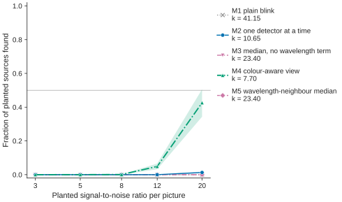
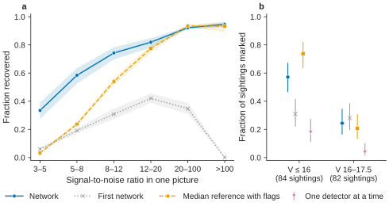
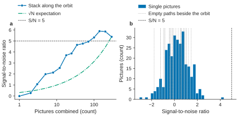
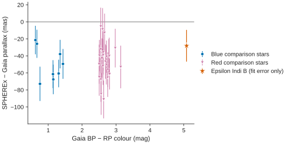
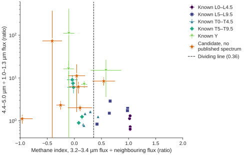
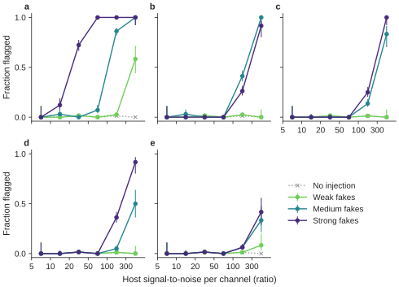
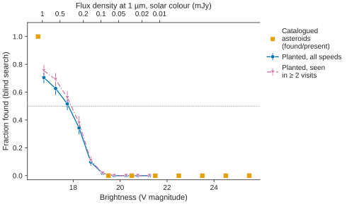

# Methods

## Abstract {#abstract}

NASA's SPHEREx telescope photographs the whole infrared sky again and again, but each photograph of a given spot is taken in a slightly different colour. Because of this, simply flicking between pictures makes ordinary stars appear to change. Epoch plays all 1,179,406 public pictures of the first data release in time order and compares each picture with the previous picture taken by the same detector, which removes most of these false changes. To reach objects too faint for one picture, it adds up many pictures along a known path. This page sets out every method we used: the mathematics, how each method was tested on data it was not tuned on, what it measured, and which methods we tried and did not keep.

## 1. Data {#data}

All measurements use the Level-2 spectral images of SPHEREx Data Release 1 (DR1; doi:10.26131/IRSA678), read pixel by pixel from NASA's public archive copy. SPHEREx (Bock et al. 2026) images the sky with six 2040 × 2040-pixel detectors at 6.15″ per pixel. Detectors 1–3 cover 0.75–2.42 µm and detectors 4–6 cover 2.42–5.0 µm, and the pairs 1–4, 2–5 and 3–6 are exposed simultaneously. Each detector sits behind a linear variable filter, so the wavelength it records changes smoothly across its face. A source lands at a different wavelength on every visit and builds up a 102-channel spectrum over several visits, at a resolving power of about 41 on detectors 1–3, 35 on detector 4, and 110 and 130 on detectors 5 and 6.

**Wavelength map.** For each detector the archive's spectral coordinate table gives the central wavelength $\lambda_c(x, y)$ and bandwidth $\Delta\lambda(x, y)$ on a grid of nodes; we interpolate bilinearly between nodes. In DR1 the table is the same for every picture of a detector.

, interpolated from the archive's spectral coordinate tables, with the position of one constant star near the north ecliptic pole in each of its 17,832 pictures (white points). Each visit places the star at a different point along the wavelength gradient, so its spectrum builds up over the year.")

**Archive, index and flags.** Each Level-2 file holds a calibrated image in MJy sr⁻¹, its variance, a quality-flag plane, a zodiacal-light model, the effective PSF and a TAN-SIP coordinate solution. Files are read by HTTPS range requests, so a small cutout costs kilobytes rather than the whole file. Our index of the release, built from the bucket listing and a range read of every header, holds 1,179,406 pictures taken between 2025-04-24 and 2026-05-14, each with detector, time, footprint and quality assessment. Photometry masks the flags SUR_ERROR, NONFUNC, MISSING_DATA, HOT, COLD, NONLINEAR, PERSIST, BLOOM, SNOWBALL, HALO and SATELLITE_HALO (the photometry mask of Akeson et al. 2026), plus OVERFLOW for sources that may saturate. OUTLIER and TRANSIENT are kept, because the pipeline sets them on pixels that changed between exposures, which includes moving and variable sources.

**Effective PSF.** The archive's effective PSF, ePSF (Anderson & King 2000), is the optical PSF convolved with the pixel response, tabulated at five times the native sampling for zones across each detector. Its value at an offset is the fraction of a source's flux falling in a native pixel at that offset, so a model image needs only interpolation. We use the zone nearest the source, interpolate with bicubic splines, and keep the 7 × 7 native pixels around the source, renormalised to unit sum. *Simplification:* fluxes are therefore the flux inside this box, without an aperture correction for the outer wings. The missing fraction is a few per cent and the same in every picture of a zone, so it cancels in ratios and light curves but not in absolute comparisons. On the same pixels of five isolated, non-variable stars, our fluxes are 0.97–1.00 times those of IRSA's published SPHEREx aperture-photometry recipe, depending on detector, as this missing wing predicts.

**Picture model.** Within a cutout, the data are modelled as point sources on a planar background:

$$
d(\mathbf{x}) = \sum_{k} A_k\,\mathrm{ePSF}(\mathbf{x}-\mathbf{x}_k) + b(\mathbf{x}),
\qquad
b(\mathbf{x}) = c_0 + c_1\,(x-\bar{x}) + c_2\,(y-\bar{y}).
$$

The positions $\mathbf{x}_k$ are fixed: every Gaia DR3 star brighter than $G = 19$–$19.5$, moved with its proper motion to the picture's time, plus the target at its predicted position. Only the amplitudes are free. With design matrix $X$, parameters $\boldsymbol{\beta} = (A_1, \dots, A_K, c_0, c_1, c_2)$ and $W = \operatorname{diag}(1/\sigma_p^2)$ from the archive variance, the weighted least-squares solution and its covariance are

$$
\hat{\boldsymbol{\beta}} = \left(X^{\mathsf T} W X\right)^{-1} X^{\mathsf T} W\,\mathbf{d},
\qquad
\operatorname{Cov}\left(\hat{\boldsymbol{\beta}}\right) = \left(X^{\mathsf T} W X\right)^{-1}.
$$

Masked pixels are excluded, and the system is solved by singular-value decomposition of $W^{1/2}X$, discarding singular values below $10^{-12}$ of the largest, so coincident sources give a large, correctly reported error rather than a numerical failure. Flux density is $F = A\,\Omega$, with $\Omega$ the pixel solid angle. Fit quality near the source is a local $\chi^2$ within 2 pixels, with $n_\mathrm{local} - \sum_i h_{ii}$ degrees of freedom, where $h_{ii}$ are the leverages.

**Error model.** Repeated measurements scatter more than the archive variance implies. For photometry of many sources each formal error is rescaled with two numbers per detector $d$, measured on stars not known to vary:

$$
\sigma_i^2 = \left(s_d\,\sigma_{\mathrm{formal},i}\right)^2 + \left(f_d\,M_i\right)^2 ,
$$

where $M_i$ is the source's model flux in picture $i$. $s_d$ makes the median reduced $\chi^2$ of the static model (Section 7) equal 1 for constant stars of $15 \le G < 17$ with $f_d = 0$; $f_d$ then does the same for constant stars brighter than $G = 13$. At the north ecliptic pole:

| Detector | 1 | 2 | 3 | 4 | 5 | 6 |
|---|---|---|---|---|---|---|
| $s_d$ | 1.38 | 1.55 | 1.44 | 1.18 | 1.11 | 1.19 |
| $f_d$ | 2.1% | 2.8% | 2.5% | 0.99% | 1.4% | 2.0% |

Wherever a result depends on the size of an error, that error is also measured empirically, on comparison stars or empty positions in the same pictures, and the larger value is used.

## 2. Change maps {#change}

A change map marks the pixels of one picture that differ from what the other pictures of the same position predict. We compared several ways of building that prediction, all on the same grid and with the same noise model.

**Grid and noise.** Each picture is resampled bilinearly onto a north-up 6.15″ grid of 48 × 48 pixels around the target; a grid pixel is blank if any of its four native neighbours is masked. From each picture $v_e$ we subtract a 3σ-clipped median background and measure $\sigma_e = 1.4826\,\operatorname{MAD}$. Because the scene is undersampled and seen at a different wavelength and sub-pixel phase in each picture, residuals at stars exceed the pixel noise, so every map uses

$$
\sigma_p^2 = \sigma_e^2 + \left(f\,S_p\right)^2 ,
$$

with $S_p$ the reference value at pixel $p$ and $f = $ 0.151, set on a calibration field so that the median of $(v-S)^2/\sigma_p^2$ within one pixel of Gaia stars with $G < 16$ is 1. *Simplification:* for Gaussian residuals that median would be 0.455, which would give a larger floor (0.24); since the thresholds below are set empirically on these maps, the choice moves the thresholds, not the false-alarm rate. The floor also means that a star changing by less than about 15% of its brightness cannot produce a significant pixel: change maps cannot show the variability of bright stars, which Section 7 measures by photometry.

**The references.** For picture $e$ of detector $d(e)$, with background-subtracted value $v_e(p)$:

*Plain blink (M1)* compares with the previous picture in time, $q$, of any detector:

$$
z_e(p) = \frac{v_e(p) - v_q(p)}{\sqrt{\sigma_e^2 + \sigma_q^2 + \left(f\,\lvert v_q(p)\rvert\right)^2}} .
$$

*One detector at a time (M2)* uses the same statistic with $q$ the previous picture from the same detector, which is close in wavelength, so the stellar spectrum largely cancels.

*Median reference (M3)* uses $R_e(p) = \operatorname{median}_{o \in \mathcal{D}(e) \setminus \{e\}} v_o(p)$ over the other pictures of the same detector. Up to twice, the single picture deviating most at a pixel is dropped if it lies beyond $4\sigma$:

$$
z_e(p) = \frac{v_e(p) - R_e(p)}{\sqrt{\sigma_e^2 + \left(f\,R_e(p)\right)^2}} .
$$

*Median reference with per-pixel scale (M3b)* divides M3's map by a scale measured on the other pictures $o$ that M3 kept:

$$
z^{\mathrm{b}}_e(p) = \frac{z_e(p)}{c_e(p)},
\qquad
c_e(p) = \max\left(1,\; 1.4826\,\operatorname{median}_{o}\left\lvert \frac{v_o(p) - R_e(p)}{\sqrt{\sigma_o^2 + \left(f R_e(p)\right)^2}} \right\rvert\right),
$$

with $c_e = 1$ where fewer than five such pictures exist. Picture $e$ never enters its own scale, so a source present only in $e$ cannot suppress itself. The scale is large where a bright star's residual changes from picture to picture.

*Wavelength-aware fit (M4)* fits, at each pixel and detector, a straight line in wavelength by weighted least squares:

$$
m_e(p) = a_d(p) + b_d(p)\left[\lambda_e(p) - \bar{\lambda}_d(p)\right],
\qquad
z_e(p) = \frac{v_e(p) - m_e(p)}{\sqrt{\sigma_e^2 + \left(f\,m_e(p)\right)^2}} ,
$$

with the slope set to zero below four pictures and the same rejection. *Simplification:* unlike M3, picture $e$ is part of its own fit unless rejected, so a faint source slightly lowers its own residual. An independently proposed baseline (M5) takes the median of the 15 same-detector pictures nearest in wavelength, leaving $e$ out.

**Spikes, components and thresholds.** Unflagged single hot pixels, up to thousands of σ, survive in every map. Every map therefore gets the same spike rule: a pixel with $\lvert z\rvert > 5$ is zeroed if the median $\lvert z\rvert$ of its 3 × 3 neighbourhood is below 2.5. A change is an 8-connected group of at least two pixels with $z > k$; only positive groups count, since a source that appears is positive in its own picture's map. For blinks the noise term uses the reference picture's value; using the larger of the two would put the source's own flux in the denominator and cap its significance near $1/f$. For each method, $k$ is the smallest value on a 0.05 grid at which calibration fields with nothing added give at most the target rate of false changes per picture. It is then applied unchanged to test fields. At 0.01 per picture on the first calibration field, $k$ = 41.15 (M1), 10.65 (M2), 23.4 (M3) and 7.7 (M4).

**Injection–recovery.** One point source per picture is planted in the raw native cutout with the picture's own ePSF zone, before resampling, so it passes through the same interpolation as real sources. Its flux is set by the signal-to-noise a PSF fit at the known position would reach,

$$
\left(\frac{S}{N}\right)_\mathrm{frame} = \frac{F\,\sqrt{\sum_p P_p^2}}{\sigma_e},
$$

with $P_p$ the unit-sum ePSF, at levels 3, 5, 8, 12 and 20. Positions are uniform in the central 40 × 40 pixels, at least 3 pixels from Gaia stars brighter than $G = 19$, with fixed seeds. A source is recovered if a change above $k$ lies within 1.5 pixels. Intervals come from 2,000 bootstrap resamples of fields.

**Twenty random fields.** Fields were drawn uniformly on the sky by a fixed seed, 10 at Galactic latitude $\lvert b\rvert > 30°$, 5 at 15–30° and 5 below 15°. Viewing one detector at a time removes a median 93% (95% interval 90–96%) of the changes the plain blink flags, over 20 fields and 4,906 pictures. These counts use groups with $\lvert z\rvert > 5$ of either sign, without the spike rule, and for blinks the larger of the two pictures' values in the noise term. This is a statement about false changes only.

, one detector at a time (circles) and the wavelength-aware fit (triangles), ordered by Galactic latitude. Counts are summed over all pictures of a field; the vertical axis is logarithmic.")

**The wavelength-aware fit does not find fainter changes.** The test required the wavelength-aware fit to reach 50% recovery at lower signal-to-noise than every other method, with a bootstrap interval on the difference excluding zero. No method reached 50% at any level, so the criterion was not met. At S/N 20 the wavelength-aware fit recovered 43%, one detector at a time 1.3% and the median reference 0.020%. The lead of the wavelength-aware fit comes from its threshold. On test fields its false-alarm rate was 0.014 per picture against 0.005 for the median reference, so one calibration field did not hold the methods to equal rates. At a common threshold $k = 5$, recovery at S/N 20 is 69% for the median reference, 68% for M5, 51% for the wavelength-aware fit, 37% for one detector at a time and 34% for the plain blink. At that threshold the false-alarm rates differ: the plain blink flags 12,686 changes over the 20 fields, one detector at a time 599.

**Median reference against one detector at a time.** M3 and M3b were then compared with M2 on 20 new test fields and 10 ecliptic fields, each at least 0.5° from every earlier field, with thresholds pooled over eight new calibration fields at 0.01, 0.03 and 0.10 false changes per picture. A challenger beats M2 if, at two or more rates, its S/N-20 recovery exceeds M2's with the 95% interval of the paired difference excluding zero, and its realised test false-alarm rate is at most 1.5 times the target.

The test used 20 fields (4,810 pictures). At S/N 20 and 0.01, 0.03 and 0.10 false changes per picture, M3b recovers 0.64, 0.72 and 0.77, against 0.11, 0.28 and 0.42 for M2. The paired difference at 0.03 is 0.44 [0.43, 0.46], and M3b's realised false-alarm rates (0.014, 0.037, 0.146) are within 1.5 times the targets, so M3b beats M2 at all three rates. M3 recovers more than M2 too, but its realised false-alarm rate on the test fields exceeds 1.5 times the target at every rate (0.100 at 0.03), so by the rule it ties. The leave-one-out scale $c$ is what keeps M3b's thresholds transferable between fields. M2's own realised rate also overshoots (0.073 at 0.03), which favours M2. Two challengers were tested, so the single "beats" carries a mild multiple-comparison caveat. At S/N 3–5 no method recovers more than about 2%. The asteroid secondary is inconclusive: the 10 ecliptic fields hold 8 catalogued sightings of one asteroid brighter than V = 19, and no method detects it. On real asteroids (Section 3, test 1), at the same thresholds, M3b marks 79 of 166 sightings and M2 18.

 and without (M3) the leave-one-out scale, and for the previous picture from the same detector (M2). Shaded bands are 95% intervals.")

## 3. Learned change detector {#detector}

The detector below was built and tested but is not used in the tool: on real asteroids it marked 68 of 166 sightings, short of the 50% completeness we required, and fewer than the median reference with the archive's flags (79).

The learned detector ranks candidate changes by how much they resemble a point source that appeared, rather than a bright-star residual or an artefact. It follows the two-stage real–bogus design of optical transient surveys (Goldstein et al. 2015; Duev et al. 2019; Acero-Cuellar et al. 2023), with a reference built from SPHEREx's own pictures.

**Candidates.** Stage 1 takes the positive local maxima with $z^\mathrm{b} \ge 3$ of the M3b map, whose reference never contains the picture itself.

**Network.** Stage 2 scores a 9 × 9-pixel cutout around each candidate with five channels — picture/$\sigma_e$, reference/$\sigma_e$, $z^\mathrm{b}$, the scale $c_e$, and a valid-pixel mask — plus a one-hot detector vector $\mathbf{u}$. All inputs are in noise units, with no absolute flux scale: an earlier linker built on absolute features did not transfer between fields.

| Layer | Operation | Output | Parameters |
|---|---|---|---|
| Input | cutout | 9 × 9 × 5 | — |
| Conv 1 | 3 × 3 valid, 5 → 12 | 7 × 7 × 12 | 552 |
| Conv 2 | 3 × 3 valid, 12 → 16 | 5 × 5 × 16 | 1,744 |
| Conv 3 | 3 × 3 valid, 16 → 16 | 3 × 3 × 16 | 2,320 |
| Concatenate | flatten, append $\mathbf{u}$ | 150 | — |
| Dense 1 | 150 → 16 | 16 | 2,416 |
| Dense 2 | 16 → 1 | logit $s$ | 17 |
| Total | | | 7,049 |

$$
\begin{aligned}
\mathbf{h}_l &= \phi\left(W_l \ast \mathbf{h}_{l-1} + \mathbf{b}_l\right),\quad l = 1, 2, 3,\quad \mathbf{h}_0 = \mathbf{x},\\
s &= \mathbf{w}_5^{\mathsf T}\,\phi\left(W_4\left[\operatorname{vec}(\mathbf{h}_3);\,\mathbf{u}\right] + \mathbf{b}_4\right) + b_5,
\qquad
\hat{y} = \frac{1}{1 + e^{-s}} ,
\end{aligned}
$$

with $\ast$ a valid convolution and $\phi$ a pointwise nonlinearity.

Here $\phi(x) = \max(0, x)$ (ReLU). Weights are initialised He-normal and biases at zero. The convolutions are 5→12→16→16 channels on the 9 × 9 cutout; the flattened 144 values plus the six-way detector one-hot $\mathbf{u}$ feed a dense layer of 16 units. The network has 7,049 parameters. The input channels are $g(v/\sigma)$, $g(m/\sigma)$, $g(z)$, $\ln c$ and a validity mask, with $g(x) = \operatorname{sign}(x)\ln(1 + |x|)$, so that a single bad pixel at thousands of σ cannot saturate the input.

**Loss and training.** The binary cross-entropy

$$
\mathcal{L} = -\frac{1}{N}\sum_{n=1}^{N}\left[\,y_n \ln \hat{y}_n + \left(1 - y_n\right)\ln\left(1 - \hat{y}_n\right)\right]
$$

is minimised with Adam in JAX, under exactly the browser tool's preprocessing, so the weights run unchanged in the browser. The pool is 21 fields, split by field into 15 for training and 6 for validation. Positives ($y = 1$, 36,535) are sources injected with the ePSF at S/N log-uniform in 3–30, 12 passes per field. Negatives (34,729) are every candidate from passes with nothing injected: the real false candidates of stage 1. Augmentation uses the eight flips and rotations, random subsets of 50–100% of each field's pictures (which change the reference), and ±10% noise jitter. Adam (learning rate $2\times10^{-3}$ with cosine decay, batch 512, decoupled weight decay $10^{-4}$) is run for two seeds, with early stopping on validation recovery at 0.03 false candidates per picture. A six-feature logistic regression is the ablation, used instead if the network does not beat it on validation.

**Thresholds and test.** For $r \in \{0.01, 0.03, 0.10\}$ false candidates per picture, $t_r$ is the smallest score at which 12 new calibration fields, with nothing injected, give at most $r$; 0.03 is the tool's operating point. The thresholds and weights, whose hash is recorded, are applied unchanged to 20 new test fields (and, as a secondary, 10 ecliptic fields) at least 0.5° from all earlier fields. The primary statistic is recovery averaged over S/N 3, 5, 8, 12 and 20, paired against M3b and M2, with 2,000 field-bootstrap resamples. The detector beats a baseline only if both 95% intervals exclude zero and the realised false-alarm rate is at most 1.5 times the target, at two or more rates. Otherwise the tool ranks candidates by M3b. Secondary measures cover matched realised rates, 20 × 20-pixel crops, Galactic latitude, detector, and catalogued asteroids brighter than $V = 19$.

On validation the network recovers 0.48 (mean over the five S/N levels at 0.03 false candidates per picture). The logistic regression recovers 0.007 and the stage-1 statistic alone 0.0003, so the network ships. On the 20 test fields (4,815 pictures) it recovers 0.321 [0.303, 0.339], 0.413 [0.395, 0.431] and 0.528 [0.510, 0.543] at 0.01, 0.03 and 0.10. The realised false-candidate rates are 0.012, 0.032 and 0.105 per picture. By S/N at 0.03, recovery is 0.002, 0.07, 0.45, 0.70 and 0.84 at S/N 3, 5, 8, 12 and 20. M3b and M2 without flags recover at most 0.001 at every rate. Their calibrated thresholds are thousands of σ (10685 for M3b at 0.03) because unmasked bad pixels dominate their tails, so by the test's rule the network beats both at all three rates. That comparison is lopsided, so we also report a reference line that was not part of the rule: M3b with the archive's flags, as in the median-reference comparison, recovers 0.181 [0.157, 0.202] at 0.03. The network, without flags, is 0.233 [0.200, 0.267] above it. Removing the 101 test pictures that also appear in training or calibration fields changes nothing. Two limits apply. On 20 × 20-pixel crops, the default 2′ view, the network recovers 0.14 against 0.17 for flagged M3b, so it brings no gain there. And on 21 earlier ecliptic fields, real catalogued asteroids with $z$ 3–5 score below injected sources of the same $z$ (0 of 11 above threshold, against 25%; KS $p = 0.004$): the simulated sources are easier than real faint movers. On the 32 catalogued sightings ($V < 19$) of 5 asteroids in the 10 ecliptic fields, the network detects none at any rate. M3b with flags detects 12, all of one asteroid. The gain is measured on injected point sources and does not yet carry over to real moving objects. In the browser, detection on 250 pictures takes about 0.16 s at 20 pixels and 2.5 s at 78 pixels.

, the median reference with the archive's flags (a reference, not part of the test rule), and the median reference and one-detector comparison without flags. Shaded bands are 95% intervals.")

**Version 2 and tests on real objects.** The first network rejected bright real sources, because during training anything brighter than S/N 30 was a bad pixel: it marked none of the 12 sightings of (196) Philomela (V 12.7). Version 2 keeps the architecture, loss and optimiser and adds two kinds of positives: injected sources at S/N 30–3000, and real stars transplanted by shifting one picture by 6–12 pixels against its own leave-one-out reference (a positive if the star's new position is blank in the reference). Thresholds were recalibrated on the same 12 fields (realised test rate 0.038 per picture at the 0.03 setting). Test 1, real asteroids: 16 new fields drawn by seeded asteroid number from JPL Horizons ephemerides as seen from SPHEREx, 8 with V 13–16 and 8 with V 16–17.5. Of 166 sightings, v2 marks 68 (95% 0.34–0.49), v1 49, M3b with flags at the median-reference thresholds 79, M2 18, and the no-flag statistics none. The target, a lower bound above 0.5, was not met. Described without a test rule, using S/N predicted from the catalogue magnitude with the PSF FWHM fixed at 7.5″: of sightings predicted above 10 times the single-picture noise, v2 marks 43 of 51, where M3b with flags marks all of them, so it still misses some bright asteroids. Test 2, 49,234 real-star transplants on the 20 test fields: recall at S/N 3–5, 5–8, 8–12, 12–20, 20–100 and > 100 is 0.33, 0.58, 0.74, 0.82, 0.92 and 0.95, against 0.03, 0.24, 0.54, 0.78, 0.93 and 0.93 for M3b with flags.

## 4. Stacking along a known path {#stacking}

An object too faint for any single picture can be measured by combining many pictures at its predicted positions. With amplitude $a_i \pm \sigma_i$ at the predicted position in picture $i$,

$$
\hat{A} = \frac{\sum_i w_i\,a_i}{\sum_i w_i},
\qquad
w_i = \sigma_i^{-2},
\qquad
\operatorname{Var}\left(\hat{A}\right) = \left(\sum_i w_i\right)^{-1},
$$

so with equal errors the signal-to-noise grows as $\sqrt{N}$: $\hat{A}/\sigma_{\hat{A}} = \sqrt{N}\,a/\sigma$. Each $a_i$ comes from fitting the target jointly with every Gaia star and the background (Section 1). An earlier version dropped Gaia stars within 0.7 pixel of the prediction as if they were the target, and a neighbour of WISE 0855−0714 leaked into its amplitude in 9 April–May pictures; every star is now modelled. When the expected brightness varies, as for an asteroid, the code uses the matched filter with template $p_i$, the predicted flux:

$$
\hat{\alpha} = \frac{\sum_i p_i\,a_i/\sigma_i^2}{\sum_i p_i^2/\sigma_i^2},
\qquad
\sigma_{\hat{\alpha}} = \left(\sum_i \frac{p_i^2}{\sigma_i^2}\right)^{-1/2},
$$

which is measured brightness in units of the prediction, and reduces to $\hat{A}$ for $p_i = 1$, the form used for WISE 0855−0714. For asteroids, $p_i$ comes from $H$, $G$ and, where a size and albedo are catalogued, a thermal model; positions come from JPL Horizons with SPHEREx as observer.

**Empty-path null.** The formal errors miss neighbour residuals, PSF undersampling and correlated noise, so $\hat{A}/\sigma_{\hat{A}}$ is not a Gaussian significance. The same pictures are combined along the path displaced by 5–9 pixels at 40 angles each, with the scene refitted at every position. With $\zeta_j$ the null paths' nominal S/N,

$$
z_{\mathrm{null}} = \frac{\hat{A}/\sigma_{\hat{A}} - \operatorname{mean}_j \zeta_j}{\operatorname{std}_j \zeta_j},
\qquad
p = \frac{1 + \#\left\{j : \zeta_j \ge \hat{A}/\sigma_{\hat{A}}\right\}}{N_\mathrm{null} + 1}.
$$

**Why 200 paths.** The smallest attainable $p$ is $1/(N_\mathrm{null}+1)$, and the null spread is uncertain by about $1/\sqrt{2(N_\mathrm{null}-1)}$. Twenty-four paths, our first choice, cannot show $p$ below 1/25 and leave the spread uncertain by about 15%. Two hundred give a floor of $p = $ 0.005 and about 5%. For WISE 0855−0714 the 200-path spread was 1.46, against 1.07 from 24 paths.

**WISE 0855−0714.** The path uses the position, proper motion and parallax (0.449″) of Luhman & Esplin (2016), as seen from the Earth. Pictures at 4.4–5.0 µm are grouped into passes split at gaps over 30 days. In November–December 2025, 22 pictures give a nominal S/N of 17.6. Against 200 empty paths (mean -0.07, spread 1.46) that is $z_\mathrm{null} = $ 12.1, with 0 paths as bright. The earlier 16.5σ against 24 paths does not stand; 12.1σ is the figure we use. The flux density is 0.50 mJy with a formal error of 0.029 mJy; the empirical error is larger by the null spread's factor of 1.46. In April–May 2026 one artefact picture widens the null spread to 3.6, and the detection is 3.9σ, although no null path is as bright.

**Faint asteroids.** Of 8 asteroids with a null-calibrated stack, 7 have no single picture at 5σ; 3 of these exceed 5σ when combined, and all 3 are seen in both the odd and even pictures and peak at the predicted position. Against 200 empty paths, the four stacks above 4σ beat every null ($z_\mathrm{null}$ = 8.6, 7.9, 5.9, 6.0). Those stacks existed before the selection rule, so a blind test followed. 12 main-belt asteroids were drawn at random, and each one's expected S/N, $\sqrt{\sum_i p_i^2/\sigma_i^2}$, was recorded before any stack was computed. Of 5 eligible (no single picture at 5σ, expected S/N ≥ 7), 3 reached 5σ (60%, 95% interval 15%–95%), short of the 70% required. The median brightness relative to prediction was 0.92 (0.76–1.50), inside the required 0.7–1.3, and none of 288 empty paths reached 5σ. The test failed on depth because the stacked noise on empty paths is 1.2–4.4 times the formal error, so formal errors overstate a stack's depth. Every stack significance on this site uses the empty-path spread.

 and the earlier sample (open). The line marks equality.")

## 5. Astrometry and parallax {#astrometry}

A nearby star traces a small ellipse on the sky over a year as the Earth orbits; measuring that ellipse from SPHEREx positions gives its distance.

**Positions.** In each picture the target is moved over a ±1.5-pixel grid in 0.05-pixel steps, the scene is refitted at each step, and the minimum-$\chi^2$ position is kept. *Simplification:* positions are quantised at 0.05 pixel (0.31″), below the per-picture scatter. Because many pictures in a visit can share a grid value, the clipping scale below is floored at half a step.

**Model.** With tangent-plane offsets $(\Delta\alpha^\ast, \Delta\delta)$ in arcseconds about a fixed point,

$$
\begin{aligned}
\Delta\alpha^\ast(t) &= \Delta\alpha^\ast_0 + \mu_{\alpha^\ast}\,(t - t_0) + \varpi\,P_\alpha(t),\\
\Delta\delta(t) &= \Delta\delta_0 + \mu_{\delta}\,(t - t_0) + \varpi\,P_\delta(t),
\end{aligned}
\qquad
\begin{aligned}
P_\alpha &= X\sin\alpha - Y\cos\alpha,\\
P_\delta &= X\cos\alpha\sin\delta + Y\sin\alpha\sin\delta - Z\cos\delta,
\end{aligned}
$$

where $(X, Y, Z)$ is the Earth's barycentric position in au at mid-exposure (Astropy's built-in ephemeris) and $t_0$ the mean epoch. SPHEREx's low orbit changes a parallax by less than 0.02 mas. The first pass weights by formal errors; pictures more than 5 robust σ (floored at 0.155″) from their visit's median residual are dropped. In the second pass each picture's error is the scatter of the remaining residuals in its visit, and the covariance is multiplied by the reduced $\chi^2$ if above 1. A 1,000-draw bootstrap over pictures gives a second error.

**Comparison-star null.** The decisive check is the same code on the same pictures applied to 8 isolated Gaia stars ($10.5 \le G \le 13$, within 0.3°, drawn by a fixed seed), with $\Delta\varpi = \varpi_\mathrm{fit} - \varpi_\mathrm{Gaia}$. The adopted error is the largest of the fit error, the bootstrap spread and the null stars' root-mean-square $\Delta\varpi$ about zero. All 8 null stars fall below Gaia: mean -50 ± 7 mas, standard deviation 19, root-mean-square about zero 53 mas. This is a shared east–west shift of a few hundredths of an arcsecond between spring and autumn visits, of unknown cause, which mimics a negative parallax. It is not subtracted: that would assume the much redder target shares the offset of blue stars, and the adopted error already contains it.

**Epsilon Indi B**, a pair of T dwarfs 0.7–0.8″ apart that SPHEREx sees as one source, has 140 pictures with S/N > 20 in four visits, 139 after clipping. The fit gives $\varpi = $ 243 ± 53 mas, 4.6σ from zero; the fit error (19 mas) and bootstrap spread (17 mas) are smaller than the null scatter that sets the error. The $\chi^2$ of the visit means is 2.1 with parallax and 162 without. The distance is 4.12 pc (13.4 light-years, 68% interval 11.0–17.2). Gaia DR3 gives 270.7 mas for Ba, slightly biased by its orbit, and 274.8 mas for the system through Epsilon Indi A; the differences are -0.5σ and -0.6σ. The proper motion is (3951 ± 50, -2439 ± 36) mas yr⁻¹ against Gaia's (3982, -2467).

Three limits apply. Picture coordinates come from the pipeline's astrometric solution, which is tied to Gaia reference stars; "from SPHEREx alone" means no Gaia position, motion or parallax of this object is used. The unresolved pair's photocentre moves with its 11-year orbit and depends on wavelength: a steady -0.5″ declination offset from Gaia's position for Ba, the same in every visit, matches the photocentre predicted from the published orbit (Chen et al. 2022). And the first and last visits are a year apart, so the parallax rests mainly on October 2025.

**Red comparison stars.** A colour-dependent position error would give red sources a different offset from the blue null stars, so the same fit is applied to 24 Gaia stars with $G_\mathrm{BP} - G_\mathrm{RP} > 2.5$ in the same pictures.

No field around Epsilon Indi B within 0.3° holds a star this red, so the search was extended to 1.3°. The fit of the 8 blue stars reproduces the earlier values exactly. Relative to Gaia, the red stars' parallaxes are offset by -46.4 ± 4.3 mas and the blue stars' by -49.7 ± 6.8 mas. The difference, 3.3 ± 8.1 mas (0.41 standard errors; 95% interval -12.5 to 19.1 mas), is below the threshold of two standard errors, so no colour correction is applied. Across all stars the offset changes by 0.9 ± 5.0 mas per magnitude of colour. The reddest comparison star has $G_\mathrm{BP} - G_\mathrm{RP} = 3.1$ and Epsilon Indi B has 5.1. The test therefore excludes a gradual colour trend up to that colour, but not an effect peculiar to a T dwarf's spectrum. A second, wavelength test fits detectors 1–3 and 4–6 separately. The comparison stars' parallaxes from detectors 1–3 are higher by 52 ± 11 mas, equally for red and blue stars, so most of the shared offset sits in the long-wavelength detectors. Epsilon Indi B's two halves (261 ± 26 and 231 ± 26 mas) differ in the same way as the comparison stars' ($z = $ -0.35).

, visit averages (circles), and fits with proper motion only (dotted) and with parallax (dash-dot). b, visit averages with the proper motion removed, and the fitted parallax ellipse. Bars are the standard error of each visit mean.")

## 6. Spectra {#spectra}

A SPHEREx spectrum is assembled from many pictures, each giving one flux at the wavelength where the source fell.

**Channel averaging.** Fluxes $f_i \pm \sigma_i$ are binned by the central wavelength at the source and combined as $F_b = \sum_i f_i\sigma_i^{-2} / \sum_i \sigma_i^{-2}$. The error comes from the scatter. Per object, $s = \max\left(1, 1.4826\,\operatorname{MAD}\{(f_i - F_b)/\sigma_i\}\right)$, pictures beyond $5s$ are dropped once, and the bin error is $s\left(\sum_i\sigma_i^{-2}\right)^{-1/2}$. For WISE 0855−0714 the error is the larger of the formal error and the bin's spread along 24 empty paths. The browser tool's quick-look spectrum, a 3 × 3-pixel sum on the resampled grid without aperture correction, recovers 82%–91% of the fitted flux in its default 2′ view, depending on detector; the inverse ratios are its per-detector corrections.

**Comparison with JWST.** The SPHEREx spectrum of WISE 0855−0714 in 0.1 µm steps from 3.8 to 5.0 µm is divided by the JWST NIRSpec PRISM spectrum of Luhman et al. (2024) averaged over the same steps. The inverse-variance mean ratio over the 10 steps detected at 3σ is 0.97 ± 0.03. The two reddest steps, 4.8–5.0 µm, fall below JWST for reasons not established. The JWST level was tied to Spitzer by its authors, so agreement in level is not fully independent; agreement in shape is. A SPHEREx spectrum of this object is already published (Rustamkulov et al. 2026); ours is an independent check. *Simplification:* a pixel does not see a 0.1 µm box but a narrow band of equivalent width $\Delta\lambda_i$ around $\lambda_{c,i}$. The comparison was therefore repeated with JWST passed through each picture's response $T_i$, approximated as a Gaussian of that centre and equivalent width because the laboratory response curves were not available, and combined with the SPHEREx weights:

$$
P_i = \frac{\int F_\nu^{\mathrm{JWST}}(\lambda)\,T_i(\lambda)\,\lambda^{-1}\,d\lambda}{\int T_i(\lambda)\,\lambda^{-1}\,d\lambda},
\qquad
P_b = \frac{\sum_i P_i\,\sigma_i^{-2}}{\sum_i \sigma_i^{-2}}.
$$

The ratio becomes 0.968 ± 0.031, against 0.966 ± 0.031 for the box average. Plausible changes of the response shape and width, and a ±10 nm shift of the band centre, move it by -0.007 to +0.013, well inside the statistical error; the band centre matters more than the shape. The two reddest steps stay low.

, the JWST NIRSpec spectrum (thin line) averaged over the same steps (squares), and the Spitzer 4.5 µm measurement (diamond).")

**Methane index.** Methane absorbs at 3.3 µm in T and Y dwarfs but not in early L dwarfs. From bins at 2.9–3.1, 3.2–3.4 and 3.9–4.1 µm,

$$
I_{\mathrm{CH_4}} = \frac{F_{33}}{\tfrac12\left(F_{30} + F_{40}\right)},
\qquad
\left(\frac{\sigma_I}{I}\right)^2 = \left(\frac{\sigma_{33}}{F_{33}}\right)^2 + \frac{\sigma_{30}^2 + \sigma_{40}^2}{\left(F_{30} + F_{40}\right)^2},
$$

undefined if the denominator is below twice its error. The calibration set is 25 dwarfs with spectroscopic types from the 20-pc census (Kirkpatrick et al. 2021), five in each of L0–L4.5, L5–L9.5, T0–T4.5, T5–T9.5 and Y, drawn by a fixed seed. The threshold is the midpoint of the interval of cuts misclassifying the fewest calibration objects under "$I < \theta$ means T or later": $\theta = $ 0.356. An object is methane-bearing if $(\theta - I)/\sigma_I \ge 3$, L-like if $(I - \theta)/\sigma_I \ge 3$, otherwise undetermined. Leaving each object out and recomputing $\theta$, 23 of 25 receive a decisive call and 91% of those are correct; both errors are at the L/T transition. Late-L dwarfs already show some 3.3 µm absorption, so the boundary sits near L9–T1. For faint objects, fits at 12 empty positions show the scatter-based errors are too small, so calls on faint objects use the empty-position error.

**Hydrogen-line excess.** SPHEREx covers Paschen-α (1.875 µm, detector 3) and Brackett-α (4.052 µm, detector 5). In each visit, line pictures are those whose channel contains the line, $\lvert\lambda_i - \lambda_L\rvert \le \tfrac12\Delta\lambda_i$. Continuum pictures lie more than one bandwidth away, within 20% of the line wavelength and clear of other hydrogen and helium lines, with at least three on each side. A straight continuum $C(\lambda)$ is fitted to them by weighted least squares with one 5σ clip, and for each line picture

$$
r_i = \frac{f_i}{C(\lambda_i)} - 1,
\qquad
\sigma_{r,i} = \frac{\sqrt{\sigma_i^2 + \left(f_i/C\right)^2\sigma_C^2}}{C}.
$$

The visit excess $E_w$ is the inverse-variance mean of $r_i$ ($z_w = E_w/\sigma_{E,w}$), and the star's excess $E$ the mean over visits ($z = E/\sigma_E$). Calibration uses control stars, ordinary Gaia stars of similar brightness and colour 20″–200″ away and so in the same pictures:

$$
Z = \frac{z - \operatorname{median}_{\mathrm{ctrl}}(z)}{1.4826\,\operatorname{MAD}_{\mathrm{ctrl}}(z)},
$$

and likewise $Z_w$. A line is detected if $Z \ge 5$ and two or more visits, each with its own continuum, have $Z_w \ge 2$. Median and MAD ignore the tail, so the false-positive rate measured on the same controls is a fair test. The sample was 60 stars that Gaia DR3 classifies as Herbig Ae/Be or Be stars, drawn by a fixed seed, with 157 controls; the rule was meant to pass at most 2% of controls. 2 of 155 controls pass (1.3%, 95% upper limit 4.0%), and 37 of 54 testable candidates show an excess, with 0.7 expected by chance. The median excess is 14% of the continuum at Paschen-α and 20% at Brackett-α. At a line-free wavelength (4.25 µm) the rule passes no candidate. At a resolving power near 40, stellar emission cannot be separated from emission by surrounding gas.

 and Brackett-α (b) for one candidate (stars) and a control star in the same pictures (crosses); bars are 1σ. c, distribution of the line excess for candidates and controls; the dashed line is the detection threshold.")

**Censuses.** Both rules, unchanged, were applied to candidates without published classifications: the methane rule to ultracool-dwarf candidates and the line rule to new Gaia emission-line candidates.

The methane rule, unchanged (threshold 0.356; a call needs the index at least 3σ from it, with errors from 12 empty positions around each object), was applied to 985 brown-dwarf candidates from published lists: 230 from Kirkpatrick et al. (2021, 2024) and Meisner et al. (2020a, b), and 755 photometric L/T candidates from Dal Ponte et al. (2023). 687 were bright enough for a decisive call: 20 "T or later" and 667 "L-like". As a control, 53 dwarfs with spectroscopic types L0–L8.5 were measured the same way, and 0 were called "T or later". Among the 645 decisive objects photometrically typed L, 0 were called "T or later". For 13 objects already typed from SPHEREx spectra by another team, our call agreed 13 times. We searched SIMBAD, the VizieR tables of Kirkpatrick et al. (2024) and Meisner et al. (2020b), the SPIFF and SUDA tables, and arXiv (2026-11-15), and found no published spectral type for any of the 20 "T or later" objects. One, WISE 0628−8057, already has a type from methane imaging (Tinney et al. 2018). Most candidates lie 3–4.7σ below the threshold, and the strongest is CWISEP J201510.68-675005.6 (6.0σ). The number of false calls expected under the original rule is not well bounded: the 95% upper limit is 39, because it allows every decisive object to be an L dwarf. A bound computed afterwards, pooling the photometric-L objects with the known L dwarfs, is 3.6. Each candidate needs a spectrum to confirm its type.

The line rule, unchanged, was applied to stars that Gaia DR3 classifies as Be or T Tauri candidates (none of them drawn in the first test), each with matched comparison stars in the same pictures. Measurement stopped at the submission deadline after the first 691 of 816 selected fields in a fixed random order, so the cut does not depend on any measured value. 10 of 1,719 comparison stars pass (0.58%; 95% upper limit 0.98%), below the 2% the rule allows. Line emission is detected in 219 of 376 testable Be candidates and 22 of 275 T Tauri candidates, 241 of 651 in total, with 3.8 false detections expected. Of the detected stars, 88 have no emission-line or young-star type in SIMBAD; most of these are already in published Hα surveys. We searched SIMBAD, VSX and 1,867 VizieR catalogues of emission-line, Be, Herbig, T Tauri, young and Hα-emitting stars, and found no published emission-line classification for 7 stars, all Be candidates. Six of them are detected in Brackett-α only, most close to the threshold. They are candidates.

## 7. Variability {#variability}

To measure brightness changes, each source's spectrum, sampled at a different wavelength in every picture, must first be removed; what remains is a light curve.

**Static-spectrum model.** Per source and detector, the flux is a cubic B-spline in wavelength with four equally spaced interior knots,

$$
M_i = \sum_{j=1}^{8} \gamma_{d(i),j}\,B_j\left(\lambda_i\right),
$$

fitted by weighted least squares with the Section 1 errors; three iterations exclude pictures beyond 5σ from the fit only. The residual is $a_i = (f_i - M_i)/M_i$ with weight $w_i = (M_i/\sigma_i)^2$; in one-day bins with at least three pictures, $a_b = \sum w_i a_i / \sum w_i$ and $\sigma_b = \left(\sum w_i\right)^{-1/2}$.

**Statistics.** Four per source:

$$
\chi^2_r = \frac{1}{n - n_\mathrm{par}}\sum_i \left(\frac{f_i - M_i}{\sigma_i}\right)^2,
\qquad
\chi^2_{r,\mathrm{det}} = \max_d \chi^2_{r,d},
\qquad
s_2 = \frac{1}{N_b}\sum_b \left(\frac{a_b}{\sigma_b}\right)^2,
$$

and the maximum Lomb–Scargle power of $a_i$ over 0.01–10 d⁻¹, excluding periods near 1, 1/2 and 1/3 d, half a year, a year, multiples of the 98-minute orbit and the source's own window peaks. Each is normalised for brightness: with $y = \log_{10}X$, its median and $1.4826\,\operatorname{MAD}$ on calibration stars in ten magnitude bins give $z = (y - \operatorname{med})/\operatorname{scale}$. The threshold is the larger of the 99.9th percentiles of $z$ over the calibration stars and over the same stars with time labels shuffled within each detector. A source is above threshold if any statistic is, a nominal rate of at most 0.4% per source.

**Calibration on non-variable stars.** Within 0.4° of the north ecliptic pole, observed on almost every orbit, 17,832 pictures measure 2,701 catalogued sources. Gaia stars not listed as variable by Gaia DR3, VSX or Kim et al. (2026), and not in the Milliquas quasar catalogue, form the null population. It is split at random: the calibration half sets thresholds and errors, and the test half measures the false-alarm rate, 3 of 992 (0.30%, 95% upper limit 0.89%). Recovery is measured by injecting sinusoids $f\,[1 + A\sin(2\pi t/P + \phi)]$ and 8%-duty box eclipses of depth $A$ into test-half stars before the static fit, with $A$ = 1–20% and $P$ log-uniform in 0.2–50 d. The floor in each 1-mag bin is the smallest $A$ recovered at least half the time.

**Learned correction for shared systematics.** All stars in a picture share errors: zero points differ between pictures, the response varies across each detector, and slow drifts run through the year. The fractional correction for picture $i$ of source $s$ on detector $d$ is

$$
\hat{a}_i = \theta_{p(i),0} + \theta_{p(i),1}\,\ell_i + m_d\left(x_i, y_i\right) + \sum_{k=1}^{K} a_{s k}\,c_{k}\left(t_{j(i)}\right).
$$

Here $\theta_{p,0}$ is a zero point per picture $p$, and $\theta_{p,1}$ multiplies the clipped log brightness $\ell_i$, so the zero point may depend on brightness. $m_d$ is a map in 16 × 16 cells per detector, and $c_k(t_j)$ are $K$ cotrending vectors on a daily grid with per-source coefficients $a_{sk}$. Picture terms and maps are fitted jointly by weighted least squares, with backfitting and one re-clip at 5σ. The vectors come from SysRem (Tamuz, Mazeh & Zucker 2005), applied to the day-binned residuals $r_{sj}$ left after the picture terms:

$$
\min_{\{a_{sk}\},\{c_{kj}\}} \;\sum_{s,j} \frac{\left(r_{sj} - \sum_{k=1}^{K} a_{sk}\,c_{kj}\right)^2}{\sigma_{sj}^2}.
$$

*Simplification:* as in SysRem, components are found one at a time by alternating weighted least squares (30 iterations) and then subtracted, which approximates the joint minimum. When the correction is applied, each source's $K$ coefficients are refitted jointly to its own residuals, and $f_i' = f_i/(1 + \hat{a}_i)$.

**Selection by held-out χ².** Only the 992 calibration-half null stars train the model, split by star into two folds; every choice is scored on the fold not used to learn it. Among eight picture models, held-out per-picture $\chi^2$ chose the zero point with brightness term plus the detector map. $K$ is the smallest value within 1% of the minimum held-out day-binned $\chi^2$. For that score, vectors are learned on one fold, and each held-out star's coefficients are fitted on even days and scored on odd days, then the reverse. The result is $K = $ 7. A calibration star is corrected by the model from the other fold. Injections go only into test-half stars, in the order inject, correct, compute statistics. The only quantities fitted to an injected light curve are its own $K$ coefficients, so any signal they absorb is counted in the measured recovery.

**Real variable stars.** Tested on real stars across the sky, SPHEREx alone recovers 47 of 96 catalogued variable stars that it can test (long-period variables: 16 of 24), while flagging 2 of 246 steady comparison stars. R Draconis (below) peaked 2.5 days from the date predicted from earlier pictures. The per-star test is described in Section 10. Variations planted into real light curves, below, only set the depth.

**Floors before and after.** Test-half false alarms are 3/992 before and 3/992 after (0.30%). Sinusoid floors:

| AB magnitude | 15–16 | 16–17 | 17–18 | 18–19 | 19–20 |
|---|---|---|---|---|---|
| Before | 2.0% | 2.0% | 5.0% | 10% | above 20% |
| After | 1.0% | 2.0% | 5.0% | 5.0% | 20% |

At 12–15 mag the floor is 1.0% before and after, the smallest amplitude tested. Of identical injections, 350 were recovered only after correction and 0 only before. No floor rose; eclipse floors did not change. Catalogued variables above threshold went from 4/86 to 5/86; most are rotating or solar-like stars whose infrared amplitudes, near 0.1%, are below the floor. A shared signal at 79 and 95 days is reduced (136 → 103 sources peaking there) but not removed, so such periods are not treated as candidates.

 and with (b) the correction for shared errors, for amplitudes of 1% to 20%. Shaded bands are 95% intervals; the dotted line marks half recovered.")

**A periodic test: R Draconis.** This Mira variable (catalogued period 246 d) saturates the detector. It is therefore measured from unsaturated pixels 7–12 pixels from its centre, with errors from 43 comparison stars measured the same way. A sine fit to an earlier set of pictures predicted a 4.4–5.0 µm maximum on 2026-02-02; the test uses only pictures outside that set. Per detector, 30-day bins are fitted as

$$
\ln\left(1 + a_{d,b}\right) = c_0 + c_1\cos\frac{2\pi t}{P} + c_2\sin\frac{2\pi t}{P},
\qquad
A = \sqrt{c_1^2 + c_2^2},
\qquad
z_A = \frac{A}{k\,\sigma_A},
$$

with $k = $ 1.27 measured on the comparison stars' light curves, none of which reaches $z_A = 5$. It passes if $z_A \ge 5$ and the maximum falls within 15 days of the prediction. At 4.4–5.0 µm, 461 new pictures give a semi-amplitude of 0.34 ± 0.03 mag ($z_A = $ 12.3) and a maximum on 2026-02-04 ± 2 d, 2.5 d after the prediction. The sine is incomplete ($\chi^2$ = 33 for 5 degrees of freedom); with errors scaled to the scatter about the fit, the amplitude is 6.1σ. R Draconis is more saturated than any comparison star, and the new pictures span the same dates as the old, so a date-dependent instrumental effect would repeat. At 3.8–4.4 µm too few dates are covered for a fit.

 and 3.8–4.4 µm (b), in 30-day bins: pictures not used for the prediction (filled circles) and pictures used for it (open circles), with the predicted curve (dash-dot), the fitted sine (solid; a only) and the scatter of comparison stars (grey band). Bars are 1σ.")

## 8. Unsupervised anomaly search {#anomaly}

The anomaly search asks, without labels and at a measured false-alarm rate, whether any source near the north ecliptic pole has a spectrum unlike the rest.

**Features.** Pictures are averaged into 17 log-spaced channels per detector (102 in all), each a clipped inverse-variance mean with a 3% per-picture floor and errors inflated by $\sqrt{\chi^2_r}$. The spectrum is normalised by its median ($\mathbf{X}$, errors $\mathbf{S}$). Tree models use $\mathbf{Z}$: 18 coarse continuum values plus the high-pass residual (spectrum minus a seven-channel running median, over its error, clipped at ±30), so narrow features are not hidden by the continuum. The population is 2,622 sources with S/N ≥ 5. 42 sources of known rare classes (quasars, planetary nebulae, white dwarfs, emission-line and young stars, known variables) are held out of training and calibration and scored like test sources.

**Scorers.** (i) An unsupervised random forest (Baron & Poznanski 2017) of 500 trees separates real feature vectors from copies with each column shuffled independently, so only correlations distinguish them. With $n_t(\mathbf{z})$ the real training sources sharing $\mathbf{z}$'s leaf in tree $t$ (counted only if the leaf is classified real),

$$
s_\mathrm{RF}(\mathbf{z}) = 1 - \frac{1}{T\,n}\sum_{t=1}^{T} n_t(\mathbf{z}),
$$

one minus the mean forest similarity to the training set, Baron & Poznanski's weirdness. (ii) An autoencoder $p \to 64 \to 32 \to 6 \to 32 \to 64 \to p$ (ELU, linear bottleneck, $p$ channels), trained with masked mean-squared error, scores the mean of the five largest channel $\chi^2$ values $(X_c - \hat{X}_c)^2/(S_c^2 + (0.01\hat{X}_c)^2)$, so one- or two-channel features are not diluted. (iii) An isolation forest (Liu, Ting & Zhou 2008) of 500 trees scores $2^{-\mathbb{E}[h(\mathbf{z})]/c(n)}$, with $h$ the isolating path length and $c(n)$ its expectation.

**Conformal $p$-values.** Sources are split into two folds; models trained on one score the other, so scores within a fold are exchangeable. Within each fold and S/N tercile (Mondrian bins), each score becomes

$$
p = \frac{1 + \#\left\{j : s_j^{\mathrm{cal}} \ge s\right\}}{n + 1},
$$

with a population source left out of its own reference set. For a source exchangeable with the reference set its rank is uniform, so $\Pr(p \le \alpha) \le \alpha$ (Vovk, Gammerman & Shafer 2005; Bates et al. 2023). Binning by S/N makes this hold within each bin, so noisy faint spectra cannot crowd out bright ones. The combined score $S = 1 - \tfrac12\left(p_{(1)} + p_{(2)}\right)$, from the two smallest per-model $p$, is a symmetric function of the population, so its conformal rank $p_\mathrm{comb}$ is also valid. A flag requires $p_\mathrm{comb} \le \alpha = $ 0.005 and at least two models with $p \le $ 0.02; the second condition only removes flags. The control is marginal: about $\alpha$ times the number of null sources are expected to be flagged. Genuine anomalies in the reference set raise everyone else's $p$, which makes the count conservative.

**Injections.** Synthetic rare spectra were added to individual pictures of real hosts before averaging, keeping their sampling, masks and noise. They comprise unresolved hydrogen lines, water and CO₂ ice bands, a real SPHEREx T4.5-dwarf spectrum, a reddened quasar and a carbon star, each at three strengths, plus a null class. The null class is flagged at 0.83% (of 240) and catalogue-clean stars at 0.16%, against $\alpha$ = 0.5%. The medium T-dwarf spectrum is recovered 86% of the time at S/N 100–300. Narrow lines and ices are rarely flagged except in the brightest sources. Flags are triaged only above S/N 100, where the class-averaged medium-strength recovery reaches 25%.

**Result.** There are 12 flags, 7 above the floor, where 6.3 are expected by chance. Each was checked for artefacts and against SIMBAD, VSX, Gaia DR3, Milliquas, NEOWISE variables and DESI DR1 redshifts. 4 are artefacts, three in the halo of the planetary nebula NGC 6543. 3 are star-forming galaxies whose 3.3 µm hydrocarbon band is redshifted into an unusual channel. 0 remain unexplained, and none of the 42 held-out known rare sources was flagged. The search is thus sensitive only to strong, broad departures in bright sources. Its flag count is consistent with chance, and no bright source in the field has a spectrum the catalogues we checked fail to explain.

## 9. Moving objects {#movers}

Shift-and-stack looks for asteroids that no catalogue predicts, moving pixels between visits. On real objects it recovers every catalogued asteroid brighter than $V = 17$ in its six fields, and the stacking it builds on is shown on real faint asteroids and on WISE 0855−0714 (Section 4). Planted movers are used only to measure how faint it reaches.

**Shift-and-stack.** Six 0.4° × 0.4° fields within 3° of the ecliptic, away from the Galactic plane and earlier fields, were drawn by a fixed seed. Pictures within ±3 days of a reference time are resampled onto a 6.2″ grid. The static sky is removed with the per-pixel median of the same detector's pictures in other groups (exposures within 0.05 d form a group), so a slow mover cannot subtract itself. Each picture is then matched-filtered with a 1.55-pixel-FWHM Gaussian:

$$
F = \frac{\sum_p g_p w_p r_p}{\sum_p g_p^2 w_p},
\qquad
\operatorname{Var}(F) = \left(\sum_p g_p^2 w_p\right)^{-1},
$$

in V-equivalent flux $F_V = F\,S_\odot(0.55\,\mu\mathrm{m})/S_\odot(\lambda)$, so a solar-coloured asteroid has the same $F_V$ at every wavelength. Thermal emission is ignored, which is conservative. Variances are rescaled by each picture's robust S/N scatter and by a per-pixel temporal scale. Each exposure's S/N is clipped at ±5, so none can dominate. Along $\mathbf{x}(t) = \mathbf{x}_0 + \mathbf{v}(t - t_\mathrm{ref})$,

$$
\left(\frac{S}{N}\right) = \frac{\sum_e w_e F_e\left(\mathbf{x}(t_e)\right)}{\sqrt{\sum_e w_e}} ,
$$

over 147,651 rates of 0.05–1.0° per day in all directions, spaced so the trail error stays below 0.7 pixel. The detection statistic drops the visit contributing most, because in null searches the tail came from single visits holding a source static within that visit. The threshold comes from the same search with exposure times randomly permuted, ten times per field, at 0.1 false candidates per field: $T = $ 7.80, giving 0.6 false candidates expected over six fields. Of 155 catalogued asteroids in the patches, the search found the 2 brighter than $V = 17$, which are all of them, and none of the fainter ones. The depth limit comes from 1,200 planted movers, of which 268 were recovered; a logistic fit reaches half its plateau of 65% at $V = $ 18.27 ± 0.12. Clipping biases measured brightness low, to 0.59 of the true value. No uncatalogued candidate survives the filters for split halves, multiple detectors, bright stars, flagged pixels, crosstalk and single-exposure dominance. Permuting single exposures under-represents artefacts coherent within a visit. The flagged-pixel filter was also corrected after the first results were seen, and one catalogued asteroid still fails it.

## 10. Tested and not adopted {#not-adopted}

Each method below was tested like those above, on data it was not tuned on, and failed its criterion or passed in a form too weak to use.

**Learned change detector (Section 3).** On real asteroids it marked 68 of 166 sightings, with a 95% lower bound of 34% against the 50% required, and fewer than the median reference with the archive's flags (79). It is not used in the tool.

**Wavelength-aware change model.** At a common threshold it recovers 51% of planted S/N-20 sources against 69% for the plain median. It flags more changes than one detector at a time in 19 of 20 random fields (median ratio 1.26). It stays in the tool as an experimental view (Section 2).

**Native-pixel scene reference.** Modelling each picture as Gaia stars plus a plane in native pixels reached a low floor on the calibration field ($f$ = 0.041). At its threshold there ($k$ = 27.7) it recovered almost no planted sources, and on test fields it gave 0.083 false changes per picture against a target of 0.01. Infrared sources missing from Gaia appear as changes in every picture.

**Change maps for moving objects.** Of 79 sightings of catalogued asteroids brighter than $V = 19$, the wavelength-aware map found 2 and one detector at a time 0. Most were too faint for one picture; masking the OUTLIER flag, which the pipeline sets on movers, removed the brighter ones. With OUTLIER unmasked and thresholds re-set, a blind test on 10 new ecliptic fields found 0 of 17 sightings with every method. Faint asteroids are stacked instead (Section 4).

**Astrometric calibration model.** A per-detector position offset was fitted to 471 Gaia stars in 45 fields unrelated to the parallax, with the model chosen by cross-validation on one half. Tested on the other half (235 stars, 509 star-visits), it lowered the root-mean-square visit offset from Gaia from 261 to 258 mas. That is a 1.1% reduction, against the 20% required. Each star's own scatter is several times the correction, so this metric could not fall by 20%. The offset, a few thousandths of a pixel along detector $x$, is confirmed but not applied.

**Barnard's Star.** Its position was measured from the centre of symmetry of its unsaturated wings, with the estimator chosen on 26 comparison stars. The measured northward motion is 10.34 ± 0.37″ yr⁻¹, against Gaia's 10.36″ yr⁻¹. Faint neighbours in the same pictures, however, share an east–west drift beyond their errors, so the test, which required them to agree with Gaia, failed.

**Per-star change test for saturated stars.** A static spectrum with one free brightness factor per visit reduced comparison-star pulls to unity. With 7 null stars, though, the smallest attainable $p$ was 0.125, so no verdict was possible. For RW Aurigae the static model fails because of saturated wings ($\chi^2$ of 516 thousand for 207 degrees of freedom); R Draconis left 3 usable pictures. On catalogued variables the test passed its false-alarm part (2 of 246 comparison stars, 0.81%). It recovered 16 of 24 long-period variables, but the interval's lower bound did not exceed 50%: inconclusive. Only 24 of 52 were unsaturated enough to test.

**Bright-star artefact check.** A ring statistic set on 48 comparison-star pictures (threshold 14.4) did not detect the artefact "shell" reported around VY Canis Majoris at its detector position. Comparing spike patterns after the fact, different bright stars at that position share the pattern (correlation 0.31, 0.49, 0.49), while the same stars elsewhere have medians of 0.05–0.04. The pattern follows the detector, not the sky. This replicates Karambelkar, Sharma & De (2026).

**AGN variability spectrum and dust lag.** For 19 known AGN against 584 matched controls, no wavelength bin showed an excess variance at 3σ, and one bright Seyfert dominated the weighted mean. A stacked cross-correlation of short- and long-wavelength light curves met its formal criterion at a lag of 12.5 d. Its global maximum, however, is at zero lag (0.081 against 0.070), and the positive-lag peak sits at the window's edge. Around the global peak the centroid is 4.8 ± 3.7 d: correlated variations, no resolved lag.

 for the AGN, for all controls, and for random sets of 19 controls (1–99% band); the dotted line is the 99th percentile of the peak for time-shuffled AGN light curves.")

**Asteroid-size model.** Thermal sizes from SPHEREx 3–5 µm came out 1.14 times the NEOWISE sizes for the first 5 asteroids. A recalibration of the thermal beaming parameter was designed but its independent test set was not completed, so the model was withdrawn.

**Distant-body search.** It has been tested only on bodies planted into the pictures, not on a real distant object, so it is not used for results. At distance $d$ a body's yearly motion is dominated by parallax $\varpi = 1\,\mathrm{au}/d$, so its track is the Section 5 model with a small drift $\boldsymbol{\mu}$ for orbital motion. The code inverts the geometry exactly: for each trial distance it solves $\lvert \mathbf{E} + \rho\,\hat{\mathbf{u}} \rvert = d$ for the geocentric range $\rho$ along the apparent direction $\hat{\mathbf{u}}$, with $\mathbf{E}$ the Earth's position. We searched 0.044 deg² at the north ecliptic pole on detector 1, reusing our earlier distant-body search code unchanged. 30 visits were chosen farthest-first in time over 384 days. Sources are detected with a Gaussian matched filter at 6.5σ, and detections recurring within one pixel in three or more visits are removed as static. The rest are linked over 40 trial distances from 30 to 2,000 au. A candidate needs $\chi^2/\nu \le 4$, a parallax of at least 5σ, at least half the visits, members spanning a quarter of the baseline, and a parallax–drift correlation below 0.98, without which distance and drift cannot be separated.

In 400 searches with each visit given another visit's time, 0 produce a candidate, so the false-alarm rate is below 0.75% per search (95% upper limit). The real search finds 0 candidates. Bodies planted into copies of every visit's pixels, 48 per cell of a per-visit S/N × distance grid, pass through the whole search. A 12σ-per-visit body at 500 au is recovered at 499.7 ± 1.0 au. At 500 au half of the planted bodies are recovered from 14 Earth radii (reflected light, albedo 0.3). The best cell, 47 of 48, supports a 95% exclusion only for bodies of at least 89 Earth radii at 1,200 au. Below about 400 au the parallax loop exceeds the stamp and recovery is near zero. The field is too small, and single pictures too shallow, to exclude a planet-sized body.

. Bars are 68% Wilson intervals; the dotted line marks half recovered.")

**South-ecliptic-pole distant bodies.** The south-pole field had 26 visits over only 93 days, too short to separate parallax from drift. The 500 au check body was detected in most visits but could not be fitted, and the best cell recovered 18 of 48. This field needs a second SPHEREx season.

**RW Aurigae.** The first test found no change meeting its rule in two detectors. A second statistic, chosen after seeing per-visit values from the same pictures, exceeds every comparison star ($Q$ = 39.4, threshold 34.6, comparison maximum 31.9): brightening at 1–2 µm (48%, 39%) and fading at 4–5 µm (-21%, -34%). It is not blind and the binary is blended: a lead for the next season, not a result.

## 11. Prior work and what is new {#prior}

**SPHEREx.** Bock et al. (2026) describe the mission and survey; Akeson et al. (2026) the pipeline, its ePSF, flags and planned variability products. SPHEREx spectra of brown dwarfs are already published at scale: SPIFF (Gagné et al. 2026), 37 L0–Y4 dwarfs including WISE 0855−0714 (Rustamkulov et al. 2026), and young L/T dwarfs (Kiman et al. 2026). Our brown-dwarf spectra repeat known measurements with a per-picture fit at the moving position; we add a methane rule with leave-one-out accuracy, and a parallax. SPIFF does not model parallax, calling it negligible at SPHEREx's pixel scale, and we found no published parallax from SPHEREx positions. References come from Gaia DR3 (Gaia Collaboration, Vallenari et al. 2023), Luhman & Esplin (2016) and Luhman et al. (2024).

**Methods from other fields.** The cotrending follows SysRem (Tamuz, Mazeh & Zucker 2005) and Kepler's cotrending-basis-vector correction (Stumpe et al. 2012; Smith et al. 2012). The anomaly scorers are the unsupervised random forest (Baron & Poznanski 2017) and the isolation forest (Liu, Ting & Zhou 2008). Their calibration uses conformal prediction (Vovk, Gammerman & Shafer 2005) as conformal outlier $p$-values (Bates et al. 2023). The detector follows real–bogus classifiers for the Dark Energy Survey (Goldstein et al. 2015) and the Zwicky Transient Facility (Duev et al. 2019), and template-free detection (Acero-Cuellar et al. 2023). Shift-and-stack follows KBMOD (Whidden et al. 2019). Stacking along known orbits is established practice with NEOWISE and is not claimed as new, and the ePSF is that of Anderson & King (2000).

**What is new** is applying these methods to SPHEREx flight data, where every picture's changing wavelength is the central difficulty, and calibrating them on that data: false-alarm rates from fields, stars or time orderings not used for tuning, depths from injected sources, and significances from empty paths. We found no published learned change detector, light-curve cotrending or unsupervised anomaly search on SPHEREx flight data (search of 2026-11-15).

## 12. References {#references}

- Acero-Cuellar, T., Bianco, F., Dobler, G., et al. 2023, What's the Difference? The Potential for Convolutional Neural Networks for Transient Detection without Template Subtraction, AJ 166, 115. https://doi.org/10.3847/1538-3881/ace9d8
- Akeson, R., Dubois-Felsmann, G. P., Crill, B. P., Faisst, A. L., et al. 2026, The SPHEREx Image and Spectrophotometry Processing Pipeline, ApJS 285, 67. https://doi.org/10.3847/1538-4365/ae8843 (arXiv:2511.15823)
- Anderson, J. & King, I. R. 2000, Toward High-Precision Astrometry with WFPC2. I. Deriving an Accurate Point-Spread Function, PASP 112, 1360.
- Baron, D. & Poznanski, D. 2017, The weirdest SDSS galaxies: results from an outlier detection algorithm, MNRAS 465, 4530. https://doi.org/10.1093/mnras/stw3021 (arXiv:1611.07526)
- Bates, S., Candès, E., Lei, L., Romano, Y. & Sesia, M. 2023, Testing for outliers with conformal p-values, Annals of Statistics 51, 149. https://doi.org/10.1214/22-AOS2244
- Bock, J. J., et al. 2026, The SPHEREx Satellite Mission, ApJ 999, 139. https://doi.org/10.3847/1538-4357/ae2be2 (arXiv:2511.02985)
- Chen, M., et al. 2022, AJ, orbit and dynamical masses of ε Indi Ba and Bb. arXiv:2205.08077
- Duev, D. A., Mahabal, A., Masci, F. J., et al. 2019, Real-bogus classification for the Zwicky Transient Facility using deep learning, MNRAS 489, 3582. https://doi.org/10.1093/mnras/stz2357
- Gagné, J., Faherty, J. K., et al. 2026, A SPHEREx Pipeline and Spectral Library for Ultracool Dwarfs, ApJ. https://doi.org/10.3847/1538-4357/ae8aed (arXiv:2604.22012)
- Gaia Collaboration, Vallenari, A., et al. 2023, Gaia Data Release 3: Summary of the content and survey properties, A&A 674, A1. https://doi.org/10.1051/0004-6361/202243940
- Goldstein, D. A., D'Andrea, C. B., Fischer, J. A., et al. 2015, Automated Transient Identification in the Dark Energy Survey, AJ 150, 82. https://doi.org/10.1088/0004-6256/150/3/82
- Karambelkar, V., Sharma, Y. & De, K. 2026, arXiv:2609.28612
- Kiman, R., Bowler, B. P., Xuan, J. W., et al. 2026, Atmospheric Diversity of Giant Planet Analogs from 3–5 µm with SPHEREx, submitted to AJ. arXiv:2608.08908
- Kim, M., et al. 2026, NEOWISE variables at the north ecliptic pole. arXiv:2604.05332
- Kirkpatrick, J. D., et al. 2021, The Field Substellar Mass Function Based on the Full-sky 20 pc Census of 525 L, T, and Y Dwarfs, ApJS 253, 7. https://doi.org/10.3847/1538-4365/abd107
- Liu, F. T., Ting, K. M. & Zhou, Z.-H. 2008, Isolation Forest, Proc. 8th IEEE International Conference on Data Mining, 413. https://doi.org/10.1109/ICDM.2008.17
- Luhman, K. L. & Esplin, T. L. 2016, The Spectral Energy Distribution of the Coldest Known Brown Dwarf, AJ 152, 78. https://arxiv.org/abs/1605.06655
- Luhman, K. L., et al. 2024, JWST NIRSpec spectra of WISE 0855−0714, AJ 167, 5. https://doi.org/10.3847/1538-3881/ad0b72 (arXiv:2311.17316)
- Rustamkulov, Z., Kirkpatrick, J. D., Akeson, R., et al. 2026, SPHEREx spectra of 37 brown dwarfs, ApJ. https://doi.org/10.3847/1538-4357/ae9d66 (arXiv:2607.00543)
- Smith, J. C., Stumpe, M. C., Van Cleve, J. E., et al. 2012, Kepler Presearch Data Conditioning II – A Bayesian Approach to Systematic Error Correction, PASP 124, 1000. https://doi.org/10.1086/667697
- SPHEREx DR1 Spectral Images 2026, NASA/IPAC Infrared Science Archive. https://doi.org/10.26131/IRSA678
- Stumpe, M. C., Smith, J. C., Van Cleve, J. E., et al. 2012, Kepler Presearch Data Conditioning I – Architecture and Algorithms for Error Correction in Kepler Light Curves, PASP 124, 985. https://doi.org/10.1086/667698
- Tamuz, O., Mazeh, T. & Zucker, S. 2005, Correcting systematic effects in a large set of photometric light curves, MNRAS 356, 1466. https://doi.org/10.1111/j.1365-2966.2004.08585.x
- Vovk, V., Gammerman, A. & Shafer, G. 2005, Algorithmic Learning in a Random World, Springer. https://doi.org/10.1007/b106715
- Whidden, P. J., Kalmbach, J. B., Connolly, A. J., et al. 2019, Fast Algorithms for Slow Moving Asteroids: Constraints on the Distribution of Kuiper Belt Objects, AJ 157, 119. https://doi.org/10.3847/1538-3881/aafd2d (arXiv:1901.02492)
