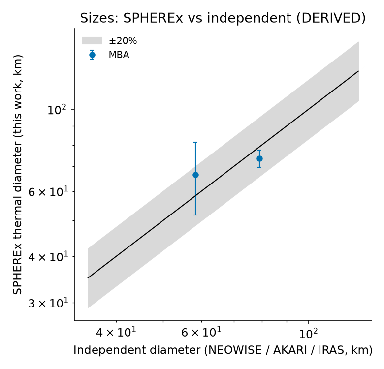
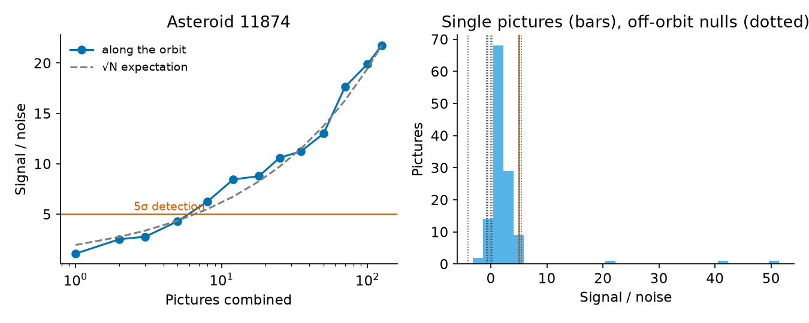
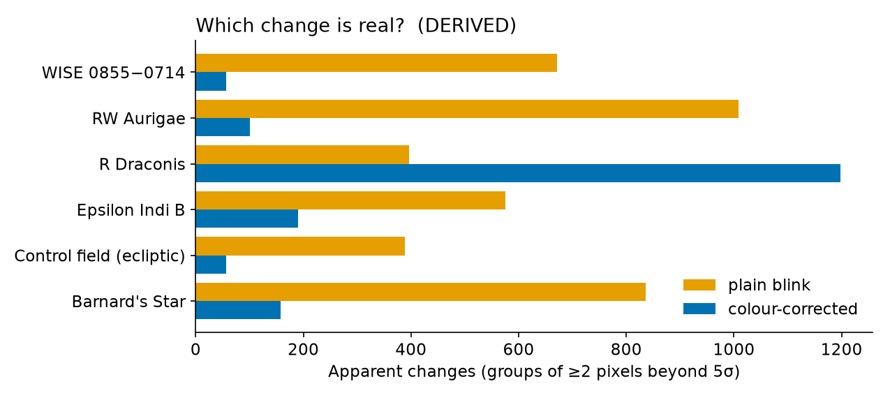
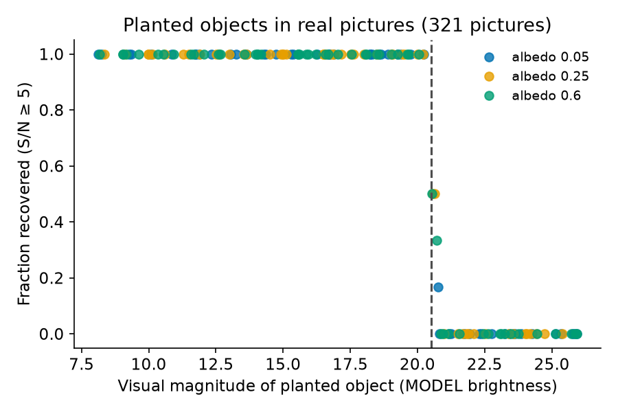

# How Orrery works, and how we checked it

## In plain words

NASA's SPHEREx telescope photographs the whole sky in 102 colours of infrared light. A star can look brighter in one picture than in the next simply because the second picture was taken in a different colour. A plain "blink" between two pictures cannot tell that apart from a real change.

Orrery predicts what each picture should look like in its own colour, then shows only what is left over. On a test patch of sky chosen in advance, this removed 85% of the apparent changes that a plain blink shows.

Orrery can also add up many pictures along the known path of an asteroid. One asteroid that sits in the noise in a typical single picture (median 1.5 times the noise level) stands out at 22 times the noise when 125 pictures are combined.

Every number on this page comes from files in the project repository, and each section says how to re-make it.

---

## Data

- **Pictures:** SPHEREx Data Release 1 (DR1), Level-2 spectral images, read directly from NASA's public archive copy on Amazon Web Services (`https://nasa-irsa-spherex.s3.amazonaws.com/dr1/`). Nothing goes through a server of ours, and nothing depends on IRSA's web services, which were failing during the hackathon.
- **Our index:** we read the header of every DR1 picture and built our own index: 1,179,406 pictures, taken from 2025-04-24 to 2026-05-14 (`scripts/build_index.py`, `scripts/build_tiles.py`). The browser loads only the small sky tiles it needs.
- **Each picture** holds an image (MJy/sr), a variance image, quality flags, a zodiacal-light model, a table of point-spread functions and a wavelength map. Detectors 1/4, 2/5 and 3/6 look at the same sky at the same moment, at short (0.75–2.4 µm) and long (2.4–5 µm) wavelengths.
- **Known positions:** JPL Horizons with SPHEREx itself as the observer (`500@-163182`), ESA Gaia DR3 stars, CDS SIMBAD for the five test targets, IMCCE SkyBoT for known-asteroid labels.
- **Reference values for checking:** NEOWISE diameters (via JPL SBDB and PDS), IRAS and AKARI diameters as listed by SBDB, Gaia DR3 asteroid reflectance spectra.

## The model

**In words.** For one small patch of sky around an object, each picture is described as: a blurred point of light at the object's predicted position, plus blurred points at every known Gaia star, plus a gently tilted background. The blur shape is the telescope's own measured point-spread function for that part of the detector. Brightnesses are solved together, weighting each pixel by how noisy it is. Pixels marked as broken are left out; pixels flagged "source", "outlier" or "transient" are kept, because moving objects set those flags.

```
model(p) = A · PSF(p − x_obj) + Σ_k B_k · PSF(p − x_k) + c0 + c1·(x − xm) + c2·(y − ym)
minimise  χ² = Σ_p [image(p) − model(p)]² / variance(p)
flux_mJy = A · Ω_pix / 206264.806² · 1e9
```

We wrote this model twice, independently (one with numpy, one with JAX, different interpolation). On real pictures the two agree within 0.23σ. We checked the orientation of the point-spread function on real data: as stored, it fits bright asteroids better than any flipped or rotated version. All flux errors include the 3% systematic floor given in the SPHEREx Explanatory Supplement.

## Sizes and colours

**Sizes.** An asteroid's brightness at 3–5 µm is mostly its own heat. We fit the near-Earth asteroid thermal model (NEATM; Harris 1998) to those pictures, with the beaming parameter η given a prior of 0.95 ± 0.20 as in Masiero et al. (2021), and with uncertainties from repeated random draws. Across the 2 asteroids with an independent reference size, our median size ratio to the reference is 1.03, with a robust scatter of 15%. 100% of them agree with the reference within 20%. The spread of differences divided by their stated errors is 0.60 (1.0 would mean the errors are exactly right). These are model estimates with an assumed η, not survey diameters; Masiero et al. (2021) give about 30% as the floor for this kind of estimate.



**Colours.** We compare the shape of our reflectance spectrum with Gaia DR3 over 0.74–1.03 µm, using only pictures from one visit. Across 2 asteroids the median χ² per degree of freedom is 0.59. Comparing across visits failed (for 224 Oceana the spectral slope disagreed with Gaia well beyond the errors, docs/CLAIMS.md C4), because asteroids rotate and change brightness between visits, so we compare within visits only.

 against Gaia DR3.")

**3 µm water band: no claim.** We measured a 3 µm band depth, but it moves when we change how the continuum is drawn. Until it does not, we make no water claim.

## Stacking along an orbit

For an asteroid with a known orbit, we predict where it is in every picture. We subtract the fitted stars and background, centre each leftover picture on the predicted position, and add them with weights proportional to the expected brightness divided by the noise squared (a matched filter, after Kaiser). The result is in units of "fraction of the expected brightness".

```
stack(p)  = Σ_e w_e · expected_e · residual_e(p) / Σ_e w_e · expected_e²     (w_e = 1/variance)
â ± σ_â    = Σ_e expected_e·A_e/σ_e² / Σ_e expected_e²/σ_e²  ±  (Σ_e expected_e²/σ_e²)^(-1/2)
```

**Result.** Asteroid 11874: median single-picture signal-to-noise 1.5, stack signal-to-noise 22 from 125 pictures. The gain in depth is 3.0 magnitudes, against 3.0 expected for perfect noise-limited adding. The brightest single picture reached 51 times the noise; a value above 5 means at least one picture shows something at the predicted spot, and we have not yet checked each such picture by eye.

**Null test.** The same pictures stacked on paths shifted 6–9 pixels off the orbit, in 8 directions, give 0.59 ± 3.0.



**Not new.** Stacking along known orbits is established: NEOWISE (Masiero et al.), the KBMOD shift-and-stack search (Whidden et al. 2019), IRSA's MOST tutorial, and other Space Apps 2026 teams. We use it as a measured demonstration and a depth calibration, not as a new method.

## Which change is real

**Revision 2 (in use).** For each sky patch, all pictures are put on one north-up grid. For each pixel and each detector we fit brightness as a straight line in wavelength across visits. The "corrected" picture is what remains after that fit, divided by the noise. The plain blink compares each picture with the previous one in time. A "change" is two or more touching pixels beyond 5σ. Both maps use the same noise model, including a floor proportional to the static brightness:

```
v_e(p)   = a_d(p) + b_d(p) · (λ_e(p) − λ̄_d)          per pixel p, detector d, picture e
σ²_e,p   = σ_e² + (f · |S_p|)²                         S_p = static-sky value
r_e(p)   = (v_e(p) − model_e(p)) / σ_e,p               corrected
n_e(p)   = (v_e(p) − v_e'(p)) / √(σ²_e,p + σ²_e',p)    plain blink, e' = previous picture
fraction removed = 1 − N_changes(corrected) / N_changes(plain blink)
```

**The noise floor was frozen first.** The value f = 0.15 was measured on a calibration field (RA 7.79°, Dec −65.37°, not a test target) as the value that makes the median corrected χ² on bright Gaia stars equal 1, and frozen before any test field was analysed (`data/findings/f1_calibration.json`).

**Result.** On the control field on the ecliptic (RA 180°, Dec 0°, declared in advance as the field without a special target), the plain blink shows 389 changes and the corrected view 57: 85% removed (± 1.8%, binomial; changes in one field are not fully independent). Over all six fields together the fraction is 55%.

**R Draconis is a pulsating star.** It really changes in every picture, so the corrected view shows more changes there than the plain blink. That is correct behaviour. Many R Draconis pictures also could not be read at the time of the run.

**Revision 1 failed.** On real data it gave more changes after correction than before. Causes: the point-spread function is undersampled, so re-gridding leaves residuals at bright stars; rejecting outliers with 3–4 pictures per detector is unstable; and single bad pixels. Revision 2 adds the frozen noise floor, gentler rejection and bad-pixel removal.

**Not yet tested:** an ablation that keeps the noise floor but drops the wavelength term. Until then, part of the reduction may come from the noise floor rather than the colour model.



## Planted test objects

We plant artificial asteroids, using each picture's own point-spread function, at 8 positions 7.5 pixels off a real asteroid's track (real stars, real noise, real artefacts), refit the scene exactly as for real objects, and stack. "Recovered" means stack signal-to-noise ≥ 5. Brightness comes from reflected light (and heat where relevant) for a grid of sizes, distances and albedos, in an opposition-like geometry (distance from Earth = distance from Sun − 1 au, phase 0°); that geometry is a model, not a real orbit.




These are limits on what this stack could have seen. They are not a search for Planet X, and we report nothing about Planet X beyond them.

## Error budget

| Term | Size | How handled |
|---|---|---|
| Statistical (pixel noise) | per measurement | from the variance image, propagated through the fit |
| Point-spread-function model | 3% of flux | systematic floor added to every flux (SPHEREx Explanatory Supplement) |
| Absolute magnitude H | about 0.1 mag | enters reflected light and size; drawn in the size uncertainty |
| Beaming parameter η | prior 0.95 ± 0.20 | marginalised in the size fit (Masiero et al. 2021) |
| Rotation | up to about 1.5 mag between visits | colours compared within one visit only |
| Solar spectrum zero point | 2.6% | CALSPEC model against V_sun = −26.76 (Willmer 2018) at 0.55 µm; not corrected |
| Wavelength map (WCS-WAVE) | about 1 nm | coarse map used; per-pixel calibration product not yet used |
| Pixel solid angle | 0.5% | header median used instead of a per-pixel map |

## Limits and what is not done

- DR1 only. Later releases need only a new index (`scripts/build_tiles.py`).
- Spectra on the fly in the browser use quick aperture sums, not the full model.
- Sizes rest on an assumed η; they are model estimates, not survey diameters.
- No water (3 µm) claim, no taxonomy claim.
- The change model has no ablation of the noise floor yet.
- The asteroid samples for sizes and colours are small (2 objects with reference sizes).
- No search for unknown objects was run. Nothing here is a detection of Planet X.

## What we tried that failed

- **Change model revision 1:** more changes after correction than before. Replaced by revision 2 with a frozen noise floor.
- **Colours across visits:** asteroids rotate, so slopes disagree with Gaia. Replaced by within-visit comparison.
- **3 µm band depth:** depends on the continuum choice. Dropped from claims.
- **IRSA web services:** search and cutout services returned errors during the hackathon. Replaced by our own index and direct reads from the public archive copy.

## Reproduce every figure

Python 3.12 with the packages in the Acknowledgements; run from the repository root.

```
# index of every DR1 picture, then browser sky tiles
.venv/bin/python scripts/build_index.py --release dr1
.venv/bin/python scripts/build_tiles.py --release dr1

# noise floor on the calibration field (frozen), then the test fields
.venv/bin/python scripts/build_field.py --name calib --ra 7.79 --dec -65.37 --size 160 --calibrate
.venv/bin/python scripts/build_field.py --size 48 --name ecliptic_control --ra 180.0 --dec 0.0 --title 'Control field on the ecliptic (RA 180, Dec 0)'
.venv/bin/python scripts/build_field.py --size 48 --name barnard --ra 269.4520769586187 --dec 4.693364966576667 --target-name "Barnard's Star" --kind star --pmra -801.551 --pmdec 10362.394 --plx 546.9759
#   (the other targets: see data/findings/run_targets.log for the exact commands)
.venv/bin/python scripts/aggregate_f1.py barnard epsindib wise0855 rwaur rdra ecliptic_control

# asteroid photometry, sizes and colours, stack, planted objects
.venv/bin/python scripts/ephem.py --ids <ids>
.venv/bin/python scripts/run_forced.py --ids <ids> --stamps
.venv/bin/python scripts/build_objects.py
.venv/bin/python scripts/build_reveal.py --ids-file data/faint_ids.txt
.venv/bin/python scripts/build_injections.py --track <pdes>
.venv/bin/python scripts/build_findings.py

# fill the numbers on this page
python3 scripts/fill_tokens.py
```

Each object page also carries its own re-run command and the archive address of every picture used.

## References

- SPHEREx Explanatory Supplement v2.1. https://irsa.ipac.caltech.edu/data/SPHEREx/docs/SPHEREx_Expsupp.pdf
- SPHEREx DR1 Spectral Images, doi:10.26131/IRSA678. https://doi.org/10.26131/IRSA678
- SPHEREx Archive at IRSA User Guide. https://caltech-ipac.github.io/spherex-archive-documentation/
- Bock et al. 2026, The SPHEREx Satellite Mission, ApJ. https://doi.org/10.3847/1538-4357/ae2be2
- Akeson et al. 2026, The SPHEREx Image and Spectrophotometry Processing Pipeline, ApJS. https://doi.org/10.3847/1538-4365/ae8843
- Hui et al. 2026, Spectral Response of SPHEREx, ApJS. https://doi.org/10.3847/1538-4365/ae522c
- Korngut et al. 2026, The SPHEREx Instrument, arXiv:2603.29835. https://arxiv.org/abs/2603.29835
- Harris 1998, A Thermal Model for Near-Earth Asteroids, Icarus 131, 291. https://doi.org/10.1006/icar.1997.5865
- Bowell et al. 1989, Application of photometric models to asteroids, Asteroids II.
- Masiero et al. 2021, Asteroid Diameters and Albedos from NEOWISE Reactivation Years Six and Seven, PSJ 2, 162. https://doi.org/10.3847/PSJ/ac15fb
- Galluccio et al. 2023, Gaia DR3: Reflectance spectra of Solar System small bodies, A&A 674, A35. https://doi.org/10.1051/0004-6361/202243791
- Bohlin et al. 2014, Absolute Flux Calibration from the Ultraviolet to the Mid-Infrared, PASP 126, 711. https://doi.org/10.1086/677655
- Bohlin, CALSPEC solar model sun_mod_001. https://archive.stsci.edu/hlsps/reference-atlases/cdbs/current_calspec/sun_mod_001.fits
- Willmer 2018, The Absolute Magnitude of the Sun in Several Filters, ApJS 236, 47. https://doi.org/10.3847/1538-4365/aabfdf
- Prša et al. 2016, IAU 2015 Resolution B3, AJ 152, 41. https://doi.org/10.3847/0004-6256/152/2/41
- Anderson & King 2000, Toward High-Precision Astrometry with WFPC2, PASP. https://doi.org/10.1086/316632
- Whidden et al. 2019, Fast Algorithms for Slow Moving Asteroids, AJ 157, 119. https://doi.org/10.3847/1538-3881/aafd2d
- Usui et al. 2019, AKARI/IRC near-infrared asteroid spectroscopic survey, PASJ 71, 1. https://doi.org/10.1093/pasj/psy125
- Lisse et al. 2026, Preliminary Results from the 1st Six Months of SPHEREx Solar System Observations, LPSC. https://www.hou.usra.edu/meetings/lpsc2026/pdf/1833.pdf
- Mahlke et al. 2026, The SPHEREx Year 1 Census of Asteroid Spectral Diversity, EPSC2026-797. https://doi.org/10.5194/epsc2026-797
- Gagné et al. 2026, SPIFF. https://github.com/jgagneastro/SPIFF
- IRSA tutorials: SPHEREx introduction, ePSF extension, MOST queries. https://caltech-ipac.github.io/irsa-tutorials/
- JPL Small-Body Database API. https://ssd-api.jpl.nasa.gov/doc/sbdb.html
- WiseView (Backyard Worlds), the model this tool follows. http://byw.tools/wiseview

## Acknowledgements

This publication makes use of data products from the Spectro-Photometer for the History of the Universe, Epoch of Reionization and Ices Explorer (SPHEREx), which is a joint project of the Jet Propulsion Laboratory and the California Institute of Technology, and is funded by the National Aeronautics and Space Administration.

This research has made use of the NASA/IPAC Infrared Science Archive, which is funded by the National Aeronautics and Space Administration and operated by the California Institute of Technology.

SPHEREx DR1 Spectral Images: doi:10.26131/IRSA678. This work has made use of data from the European Space Agency (ESA) mission Gaia, processed by the Gaia Data Processing and Analysis Consortium (DPAC); Gaia DR3 was queried through the AIP mirror. It also uses JPL Horizons and the JPL Small-Body Database, NEOWISE diameters from the Planetary Data System, IMCCE SkyBoT and CDS SIMBAD. Orrery is not endorsed by NASA.

Software: astropy, numpy, scipy, pandas, pyvo, astroquery, matplotlib, jax, fsspec, aiohttp, requests, Pillow.
