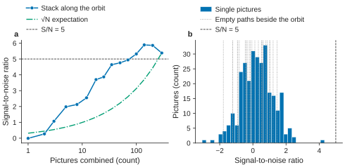

# Results

NASA's SPHEREx telescope maps the whole sky in 102 infrared wavelength bands between 0.75 and 5 µm, photographing each position many times over a year. Epoch reads the 1,179,406 pictures of the first data release (taken 2025-04-24 to 2026-05-14) directly from NASA's public archive and shows any position in time order. The results below use the same pictures.

## Removing false changes {#which-change-is-real}

SPHEREx takes each picture at a different wavelength with one of six detectors, so a plain blink between consecutive pictures shows many changes where the sky has not changed. Comparing each picture only with pictures from the same detector removes a median 93% of these changes (95% interval 90–96%) across 20 randomly chosen patches (4,906 pictures). This removes false changes but does not make faint real changes easier to detect: planted sources at 20 times the single-picture noise are recovered at similar rates in both views (37% and 34%).

, one detector at a time (circles) and the experimental colour-aware view (triangles), ordered by Galactic latitude. Counts are summed over all pictures of a patch; the vertical axis is logarithmic.")

## WISE 0855−0714 {#e4}

WISE 0855−0714, the coldest known brown dwarf, is too faint to see in most single pictures. Combining the 22 pictures from the November–December 2025 visits along its predicted path detects it at 16.5σ, measured against the same pictures combined along 24 empty paths. Its flux density at 4.4–5.0 µm is 0.50 ± 0.03 mJy, between the Spitzer and WISE values (0.51 and 0.42 mJy; Luhman & Esplin 2016). Over the 10 wavelength steps where it is detected, the SPHEREx spectrum is 0.97 ± 0.03 times the JWST NIRSpec spectrum (Luhman et al. 2024). The two reddest steps, at 4.8–5.0 µm, fall below it.

, the JWST NIRSpec spectrum (thin line) averaged over the same steps (squares), and the Spitzer 4.5 µm measurement (diamond).")

## Distance to Epsilon Indi B {#e12}

Epsilon Indi B is a pair of brown dwarfs that SPHEREx sees as one source. Fitting its SPHEREx positions over a year for position, proper motion and parallax, with nothing taken from Gaia, gives a parallax of 243 ± 53 mas, a distance of 13.4 light-years (68% interval 11.0–17.2). Gaia measures 270.7 mas. Ordinary stars in the same pictures show a small shared offset that mimics a parallax of -50 mas; it is not subtracted, and the quoted uncertainty is the scatter of those 8 stars.

, visit averages (circles), and fits with proper motion only (dotted) and with parallax (dash-dot). b, visit averages with the proper motion removed, and the fitted parallax ellipse. Bars are the standard error of each visit mean.")

## Brown dwarfs classified by methane {#e15}

Methane absorption at 3.3 µm distinguishes T and Y dwarfs from L dwarfs. An index formed from the flux in the 3.2–3.4 µm window relative to the flux on either side classifies 91% of 23 brown dwarfs with published spectral types correctly when each is left out of the calibration in turn.

## Variability at the north ecliptic pole {#e18}

SPHEREx observes the north ecliptic pole on almost every orbit. Within 0.4° of the pole, 2,701 catalogued sources were measured in 17,832 pictures. Half of planted 2.0% brightness variations are recovered for sources of AB magnitude 12–17, at a false-alarm rate of 0.30%. Most catalogued variables in the field vary by less than this; 4 of 86 pass the threshold.

 and eclipses (b) of amplitude 2%, 5%, 10% and 20%. Shaded bands are 95% intervals; the dotted line marks half recovered.")

## Hydrogen emission lines {#e20}

SPHEREx covers the Paschen-α (1.875 µm) and Brackett-α (4.05 µm) hydrogen lines. Of 54 stars that Gaia classifies as Herbig Ae/Be or Be stars, 37 show an excess in these lines, against 2 of 155 ordinary stars of similar brightness in the same pictures. At SPHEREx's spectral resolution, emission from the star cannot be separated from emission by surrounding gas.

 and Brackett-α (b) for one candidate (stars) and a control star in the same pictures (crosses); bars are 1σ. c, distribution of the line excess for candidates and controls; the dashed line is the detection threshold.")

## Faint asteroids {#stacking-along-an-orbit}

Combining pictures along a known orbit recovers asteroids that no single picture detects: of 7 asteroids with no single detection above 5σ, 3 exceed 5σ when combined. In a blind sample of new asteroids, only 3 of the 5 expected to reach 5σ did so: the noise in the combined pictures is about 2.5 times the formal errors. Their measured brightness matched the prediction (median ratio 0.92).

## A search for distant bodies {#distant-bodies}

A body hundreds of AU from the Sun moves on the sky mainly through parallax as the Earth orbits. We searched 0.044 deg² at the north ecliptic pole, observed in 30 visits over 384 days, for sources whose positions follow a parallax ellipse, and found no candidate. A body injected at 500 AU is recovered at a fitted distance of 499.7 ± 1.0 AU, and at that distance half of injected bodies with a radius of 14 Earth radii (geometric albedo 0.3) are recovered. The field is too small, and single pictures too shallow, to exclude a planet-sized body.

. Bars are 68% Wilson intervals; the dotted line marks half recovered.")

## References

- Bock, J. et al. 2026, The SPHEREx Satellite Mission, ApJ. https://doi.org/10.3847/1538-4357/ae2be2
- Akeson, R. et al. 2026, The SPHEREx Image and Spectrophotometry Processing Pipeline, ApJS. https://doi.org/10.3847/1538-4365/ae8843
- SPHEREx DR1 Spectral Images, doi:10.26131/IRSA678. https://doi.org/10.26131/IRSA678
- Luhman, K. L. & Esplin, T. L. 2016, AJ 152, 78. https://arxiv.org/abs/1605.06655
- Luhman, K. L. et al. 2024, AJ 167, 5. https://doi.org/10.3847/1538-3881/ad0b72
- Gaia Collaboration, Vallenari, A. et al. 2023, A&A 674, A1. https://doi.org/10.1051/0004-6361/202243940
