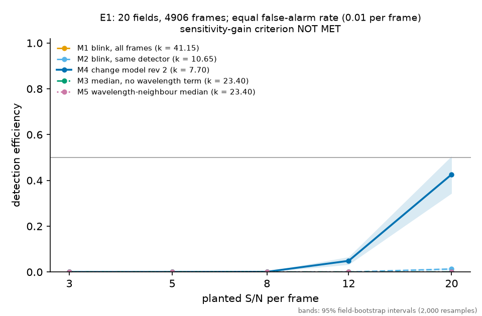
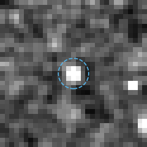
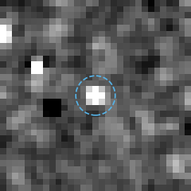
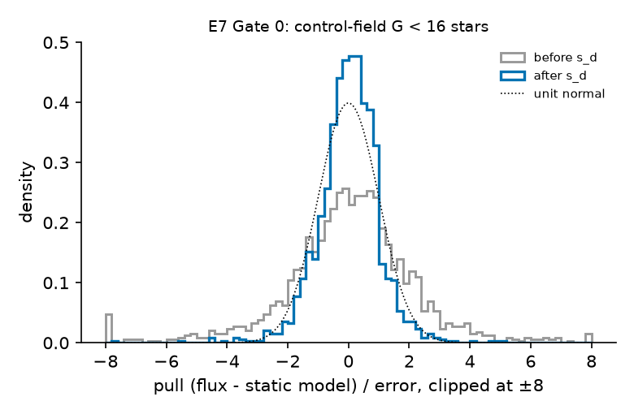

# How Orrery works, and how we checked it

## In plain words

NASA's SPHEREx telescope photographs the whole sky in 102 colours of infrared light. Orrery plays its pictures of any spot like a short film and answers one question: **at this spot in the sky, what really changed?**

The difficulty is that SPHEREx photographs each spot in a different colour every time. A star that is brighter at one wavelength than another seems to flicker from picture to picture even when nothing moved, so a plain "blink" fills with false changes. Comparing each picture only with pictures from the same detector, which see similar colours, removes most of them: a median of 93% across 20 random patches of sky.

Some objects are too faint for single pictures. Adding pictures along a known path brings them out: WISE 0855−0714, the coldest known brown dwarf, stands out at 16.5 times the spread of empty paths, between the brightnesses NASA's Spitzer and WISE measured in similar bands, and it moves between visits months apart as predicted.

We also built a cleverer, colour-aware view. In our own test, written down before we looked at the data, it did not find fainter changes than a simple median, so it is offered only as an experiment. Every test, including the ones that failed, is described below. Every result number on this page comes from result files in the project repository, and each section says how to re-make it.

---

## The question

The challenge asks for a tool where you enter the coordinates of a patch of sky and watch SPHEREx's pictures of it like a little video, so that moving objects are easy to spot. Orrery does that for any coordinates. Everything else on this page serves one question about the film you are watching: which of the changes you see are real, and which are only SPHEREx changing colour?

Orrery offers three views of change:

- **Plain blink:** every picture compared with the one before it in time.
- **One detector at a time:** each picture compared only with the previous picture from the same detector. This is the view our tests support.
- **Colour-aware view (experimental):** each picture compared with a model of the steady sky at that picture's colour. It lost its pre-registered test (below).

Some objects need a fourth tool: **combining pictures along a known path**, for objects too faint to see in a single picture.

## Data and index

- **Pictures:** SPHEREx Data Release 1 (DR1), Level-2 spectral images, read directly from NASA's public archive copy on Amazon Web Services (`https://nasa-irsa-spherex.s3.amazonaws.com/dr1/`). The browser reads only the bytes it needs. Nothing goes through a server of ours, and nothing depends on IRSA's web services, which were failing during the hackathon.
- **Our index:** we read the header of every DR1 picture and built our own index: 1,179,406 pictures, taken from 2025-04-24 to 2026-05-14 (`scripts/build_index.py`, `scripts/build_tiles.py`). The browser loads only the small sky tiles it needs.
- **Each picture** holds an image (MJy/sr), a variance image, quality flags, a zodiacal-light model, a table of point-spread functions and a wavelength map. SPHEREx has six detectors. Detectors 1/4, 2/5 and 3/6 look at the same sky at the same moment, at short (0.75–2.4 µm) and long (2.4–5 µm) wavelengths, and each detector covers its own narrow slice of the spectrum.
- **Known positions:** ESA Gaia DR3 stars; Luhman & Esplin (2016) for WISE 0855−0714; JPL Horizons with SPHEREx itself as the observer (`500@-163182`) for asteroids; CDS SIMBAD for the five test targets; IMCCE SkyBoT for known-asteroid labels.

## What a "change" is

All pictures of a 48 × 48-pixel patch are put on one north-up grid (6.15″ pixels). A change map gives, for each pixel, the difference between a picture and its reference, divided by the expected noise. A **change** is a group of two or more touching pixels beyond a threshold k.

```
blink map    n_e(p) = (v_e(p) − v_e'(p)) / √(σ²_e,p + σ²_e',p)     e' = previous picture (plain), or previous picture from the same detector
noise        σ²_e,p = σ_e² + (f · |S_p|)²                           S_p = static sky value
fraction removed = 1 − N_changes(one detector at a time) / N_changes(plain blink)
```

The term f · |S_p| is a noise floor proportional to each star's brightness. SPHEREx's pixels are large compared with its sharpest images of stars, so when pictures are lined up bright stars leave residues far larger than the background noise. The value f = 0.151 was measured on a separate calibration patch (RA 7.79°, Dec −65.37°, not a test target) as the value that makes the median χ² on bright Gaia stars equal 1, and fixed before any test patch was analysed (`data/findings/f1_calibration.json`). Every view uses the same noise rule, so comparisons between views are fair.

###### E2

## Which change is real {#which-change-is-real}

**Test E2: how many of a plain blink's changes are only colour?** Written down before the data were analysed (`docs/PROTOCOLS.md`, E2).

**Patches.** 20 patches drawn with a fixed random seed (20261115), uniform on the sky: 10 at Galactic latitude |b| > 30°, 5 at 15–30° and 5 below 15°, each with at least 40 pictures. Patches with more than 250 pictures use 250 spread evenly in time (4,906 pictures in all). The threshold is k = 5.

**Result.** Viewing one detector at a time removes a median **93%** of the changes a plain time-ordered blink shows (95% field-bootstrap interval 90–96%, 2,000 resamples). Summed over all patches, the plain blink shows 14,202 changes and one detector at a time 840. The worst patch (e2_13, Galactic latitude −61°) loses only 22%, because its plain blink had few changes to begin with (55 → 43). The per-patch counts are listed on the home page under the headline number.

**The colour-aware view did worse than this simple view.** Against one detector at a time it leaves a median 1.26 times as many changes (95% interval 1.12–1.43); it had more changes in 19 of the 20 patches.

**Control patch.** On the patch on the ecliptic declared in advance (RA 180°, Dec 0°), the counts are 389 (plain blink), 52 (one detector at a time) and 57 (colour-aware).

**What this number does and does not say.** It measures how much of a plain blink is colour flicker. Two checks on real changes: (1) planted test sources at 20 times the single-picture noise are caught about as often by the one-detector view as by a plain blink at the same alarm threshold (37%, 95% CI 31–42%, against 34%, CI 28–38%; a secondary check, at the same alarm threshold; data/findings/e2_d1.json); (2) known asteroids are almost never caught in single pictures by any of our views (one-detector 0 of 79 sightings, colour-aware 2 of 79; E3, `data/findings/e3.json`) — see [What failed #14](failed.html).

, one detector at a time (M2) and the colour-aware view (M4), sorted by Galactic latitude. Logarithmic scale.")

###### E1

## Faint changes in single pictures, and a failure

**Test E1: at the same false-alarm rate, which view finds fainter real changes?** This was our primary test, written down before the data were analysed (`docs/PROTOCOLS.md`, E1).

**Methods compared.** M1 plain blink; M2 one detector at a time; M3 a median of the other pictures from the same detector; M4 our colour-aware view; M5 a wavelength-neighbour median proposed as the strongest simple competitor.

**How.** Each method's threshold k was set on the calibration patch, with nothing planted, so that it gives one false change per 100 pictures, and then frozen. Artificial point sources were planted into the raw pictures of the 20 test patches (4,906 pictures), at 3, 5, 8, 12 and 20 times each picture's noise, at positions drawn with fixed seeds. A planted source counts as found if a change lies within 1.5 pixels of it.

**Result: the pre-registered criterion was not met.** No method found half of the planted sources even at 20 times the single-picture noise, so the comparison is a tie at "too faint for all". The colour-aware view looked ahead at the brightest level, but only because one stray spike on the calibration patch set its threshold lower (k = 7.7 against 23.4 for the median). At a common threshold the plain median found more, and on the test patches with nothing planted the colour-aware view raised more false alarms (0.014 per picture, 95% interval 0.008–0.023, against 0.005, 0.001–0.011; the intervals overlap). We therefore make no claim that the colour-aware view finds fainter changes; the headline uses the simpler one-detector view (Version B, chosen by the rule fixed in advance).

**What we learned.** Catching a change in a single SPHEREx picture only works for bright changes, about 20 times the noise or more. A clean-up rule needed to stop isolated bad pixels from swamping every method also removed some faint real sources, equally for every method (see What failed). Fainter objects need many pictures combined along their path, which is what the next sections do.



###### E4

## WISE 0855−0714, the coldest known brown dwarf {#e4}

**Test E4: is WISE 0855−0714 visible in SPHEREx pictures combined along its known path?** WISE 0855 is one of the challenge's five test targets. It is so cold that it shines mainly at the longest SPHEREx wavelengths, and it is too faint for most single pictures. Written down before the data were analysed (`docs/PROTOCOLS.md`, E4).

**Path.** Position, proper motion (-8.118, +0.680 ″/yr) and parallax (0.449″) from Luhman & Esplin (2016), who measured them with NASA's Spitzer and Hubble; the predicted position in 2025–26 is uncertain by about 0.08″, a small fraction of a pixel.

**Measurement.** In each picture we fit a point source at the predicted position together with every Gaia star nearby and a background plane, using the telescope's own measured point-spread function. Pictures with central wavelength 4.4–5.0 µm (46 of them) are combined for each set of visits (May 2025, Nov–Dec 2025, Apr–May 2026) with equal weight per unit brightness:

```
â ± σ_â = Σ_e p_e A_e / s_e² / Σ_e p_e² / s_e²  ±  (Σ_e p_e² / s_e²)^(−1/2)        p_e = 1 mJy template, A_e, s_e = fitted amplitude and error
significance = (â/σ_â − mean of nulls) / spread of nulls
```

**Nulls.** The same pictures are combined along the same path shifted 6 or 9 pixels in 24 directions, where nothing should be. The significance is measured against the spread of those 24 empty paths, not against our own error bars.

**Results.**

| Visits | Pictures | Brightness (mJy) | Significance against empty paths |
|---|---|---|---|
| Nov–Dec 2025 visits | 22 | 0.50 ± 0.03 | 16.5σ |
| Apr–May 2026 visits, neighbour star restored | 21 | 0.52 ± 0.04 | 10.6σ |
| Apr–May 2026 visits, as first declared | 21 | 0.56 ± 0.03 | 13.6σ |

The May 2025 visits have only 3 usable pictures, one of them badly fitted, and is not informative.

**Brightness.** Spitzer measured 0.51 mJy at 4.5 µm (Luhman & Esplin 2016). Our value is a flat-weighted mean over the SPHEREx channels between 4.4 and 5.0 µm, not a synthetic Spitzer magnitude, so close agreement is expected but not exact.

**A neighbour star.** Our fitting code treated any Gaia star within 0.7 pixels of the target as "the target itself" and left it out of the model. In the Apr–May 2026 visits a star of Gaia magnitude 16.3 sits 0.67–0.71 pixels from WISE 0855's predicted position. A control at 0.75–3.5 µm, where WISE 0855 is invisible, showed the leak: it gave 0.10 mJy in the Apr–May 2026 visits. With the star put back into the model the control falls to -0.006 mJy and the 4.4–5 µm signal from 13.6σ to 10.6σ. We quote the lower number. In the Nov–Dec 2025 visits the control gives -0.018 ± 0.003 mJy: small, but not zero.

**Motion between visits.** Measured shift from the Nov–Dec 2025 to the Apr–May 2026 visits: -3.3″ east–west and +2.1″ north–south (errors 0.6″ and 1.1″), against a predicted -4.5″ and +0.6″. This is consistent with the prediction (p = 0.08), and a source that does not move is ruled out (p = 3 × 10⁻⁷). The neighbour star can still pull the measured centres slightly.

**What this is.** A measurement of a known object: a point source at the predicted position of WISE 0855−0714 in SPHEREx DR1 pictures at 4.4–5.0 µm, at Spitzer's brightness, moving as predicted. It is not a new object. The slider on WISE 0855's card combines 45 pictures from all visits (neighbour restored, one poorly fitted picture dropped).





###### Motion

## Measuring how a star moves, from SPHEREx positions {#motion}

**Epsilon Indi B**, a pair of brown dwarfs 12 light-years away, is one of the challenge's test targets. In each of 140 pictures we fit its position freely (saturated pixels masked, Gaia neighbours modelled), average positions in four time windows over 374 days, and fit a straight-line motion with Gaia's parallax held fixed.

| | East–west (″/yr) | North–south (″/yr) |
|---|---|---|
| SPHEREx positions alone | 3.96 ± 0.07 | -2.43 ± 0.07 |
| Gaia DR3 | 3.98 | -2.47 |

**An offset we cannot explain.** In all four windows our positions sit a steady 0.5″ south of Gaia's prediction. A steady offset does not change the motion, but we have not found its cause. Epsilon Indi B is a pair that SPHEREx cannot separate; that is one possibility we have not tested.

**Barnard's Star did not work this way.** The same method on Barnard's Star gives a north–south motion of 5.6 ± 1.5 ″/yr, far from Gaia's 10.4 (`data/findings/motion_barnard.json`). Likely cause (untested): it is a bright star (Gaia G = 8.2) that saturates SPHEREx's detector, so with its centre masked the fit rests on its outer light; and only two time windows are available. We make no numeric motion claim for it. Its motion is still plain to see in the tool: subtracting survey 2 from survey 1 shows it as an orange–blue pair ([open it](timemachine.html?ra=269.4463&dec=4.7677&fov=2&mode=subtract)).

## Stacking along an orbit {#stacking-along-an-orbit}

For an asteroid with a known orbit, we predict where it is in every picture (JPL Horizons, SPHEREx as observer). We subtract the fitted stars and background, centre each leftover picture on the predicted position, and add them with weights proportional to the expected brightness divided by the noise squared (a matched filter).

```
â ± σ_â = Σ_e expected_e·A_e/σ_e² / Σ_e expected_e²/σ_e²  ±  (Σ_e expected_e²/σ_e²)^(−1/2)
```

**Result.** Asteroid 98397 (2000 UC3): no single picture detects it at 5σ (median 0.24σ, best 4.3σ, after dropping 23 pictures with poor local fits identically from singles and stack). Combining 295 pictures gives 5.4σ, quoted against empty paths beside the orbit. As a check, we split the pictures in two (odd and even, or first and second half in time): each half gives 3.2–4.6σ, against about 3.8σ expected for half the data if the signal is real (`data/findings/f2_split.json`). This is marginal: one object, and the error-calibration check below did not pass cleanly, so we used the larger, more conservative scale.


**Not new.** Stacking along known orbits is established: NEOWISE (Masiero et al.), the KBMOD shift-and-stack search (Whidden et al. 2019), IRSA's MOST tutorial, and other Space Apps 2026 teams. We use it as a measured demonstration, not as a new method.

###### E5

## A scene model built only from Gaia stars {#e6}

We also tried modelling every picture star by star, using ESA Gaia's catalogue (one brightness per star per picture), and treating whatever is left as change. Measured on the calibration patch, its noise allowance was small (4.1% of a star's brightness), so we ran it through the same planted-source test. It found essentially nothing at its frozen alarm threshold, and on the 20 test patches it raised far more false alarms than allowed. The likely reason: infrared sources that Gaia does not list (Gaia sees visible light) stay in every picture. Details: `data/findings/e6.json`.

## A per-star change test {#e7}

A pre-registered test (E7) looked at stars one at a time: one smooth spectrum per detector fitted to every picture of a star, against the same spectrum allowed to brighten or fade between visits, with significance judged against ordinary stars. **Error calibration (Gate 0):** on three control patches only, per-picture error bars turned out 1.1–3 times too small, depending on the detector; after a per-detector correction frozen on those patches, the pulls of constant stars have a spread of 1.01 (2.24 before) — figure `e7/gate0_pulls.png`. **Result: no verdict.** The comparison set we fixed in advance held only 7 ordinary stars, so the smallest reachable p-value was 0.125 and our p < 0.01 rule could not be met — a design error on our part. RW Aurigae and R Draconis also saturate the detector: R Draconis left 3 usable pictures of 250, and RW Aurigae's static fit is poor, so a change cannot be separated from a bad fit. Details: `data/findings/e7.json`; [What failed #16](failed.html).



## Are the error bars right?

**Test E5: error calibration for every stack.** Combining hundreds of pictures can make small, correlated errors look significant. For every stack quoted on this site, we combine the same pictures along 24 empty paths beside the real one. The spread of the 12 inner paths gives a scale factor for our error bars; the 12 outer paths check it: after rescaling, their spread must lie within 0.9–1.1. If it does not, we report the measured spread and use the larger scale.

| Stack | Scale from inner paths | Outer-path spread after rescaling | Check |
|---|---|---|---|
| WISE 0855, Nov–Dec 2025 | 1.09 | 0.94 | passed |
| WISE 0855, Apr–May 2026 | 1.34 | 0.95 | passed |
| Asteroid 98397 (2000 UC3) | 1.54 | 0.77 | not passed; larger scale used |

Before this test, our stacked error bars were 1.5–2.5 times too small for the asteroid stacks (see What failed). Every stacked significance on the site is therefore quoted against empty paths.

## Error budget

| Term | Size | How handled |
|---|---|---|
| Statistical (pixel noise) | per measurement | from the variance image, propagated through the fit |
| Point-spread-function model | 3% of flux | systematic floor added to every flux (SPHEREx Explanatory Supplement) |
| Residues at bright stars after re-gridding | f = 0.151 of the static brightness | noise floor fixed on the calibration patch before any test |
| Correlated errors in stacks | error bars 1.5–2.5 times too small (asteroid stacks) before calibration | significance against 24 empty paths; E5 scale check |
| Unmodelled neighbour stars | WISE 0855, Apr–May 2026: 13.6σ → 10.6σ | short-wavelength control; star restored; lower value quoted |
| Predicted position of WISE 0855 | about 0.08″ | from the Luhman & Esplin (2016) errors |
| SPHEREx band edges | flat mean over 4.4–5.0 µm channels | not converted to a Spitzer magnitude |
| Position offset (Epsilon Indi B) | steady 0.5″ | cancels in the motion; cause unexplained |
| Wavelength map (WCS-WAVE) | about 1 nm | coarse map used; per-pixel calibration product not yet used |
| Pixel solid angle | 0.5% | header median used instead of a per-pixel map |

The pixel model was written twice, independently (one with numpy, one with JAX, different interpolation); on real pictures the two agree within 0.23σ. The orientation of the point-spread function was checked on real data.

## Limits

- DR1 only. Later releases need only a new index (`scripts/build_tiles.py`).
- Single-picture change detection needs bright changes, about 20 times the noise or more.
- Single-picture change maps do not find faint moving asteroids (E3: 0/79 and 2/79 known-asteroid sightings); our masking of the archive's outlier flag erased the brighter ones; a follow-up pre-registered test with the flag left in (E3b) caught 0 of 17 sightings on 10 new patches (`data/findings/e3b.json`).
- The colour-aware view is experimental; it lost its pre-registered test.
- Spectra on click in the browser use quick aperture sums, not the full model.
- No search for unknown objects was run.
- Barnard's Star's motion could not be measured from SPHEREx positions alone.

### Sizes and colours

The asteroid pages show sizes from SPHEREx's 3–5 µm heat glow and colours compared with Gaia within one visit. They are evidence that the pixel model works, not claims: sizes came out about 15% too large for the first asteroids and the calibration is unfinished, and the 3 µm water band depends on how the continuum is drawn. No size, water or planet-limit result is claimed anywhere in this entry.

## What failed

We publish every approach that did not work, with what we changed: the first colour-aware model, which flagged more changes than a plain blink; the fair comparison that shrank our first headline; the colour-aware view losing its pre-registered test; error bars that were too small; a neighbour star silently dropped; and more. See [What failed](../failed.html).

## Reproduce every figure

Python 3.12 with the packages in the Acknowledgements; run from the repository root. Each step writes the result file named in the comment.

```
# index of every DR1 picture, then browser sky tiles
.venv/bin/python scripts/build_index.py --release dr1
.venv/bin/python scripts/build_tiles.py --release dr1

# noise floor on the calibration patch (fixed before any test)   -> data/findings/f1_calibration.json
.venv/bin/python scripts/build_field.py --name calib --ra 7.79 --dec -65.37 --size 160 --calibrate

# E2: draw and cache the 20 patches, count changes                -> data/findings/e2.json
OMP_NUM_THREADS=1 .venv/bin/python scripts/e2_cache.py
OMP_NUM_THREADS=1 .venv/bin/python scripts/e2_counts.py

# E1: thresholds on the calibration patch, planted sources, summary -> data/findings/e1.json, figs/fig_e1.png
.venv/bin/python scripts/run_e1.py calib
.venv/bin/python scripts/run_e1.py test
.venv/bin/python scripts/run_e1.py summary
OMP_NUM_THREADS=1 .venv/bin/python scripts/e1_test_false_rates.py  # -> data/findings/e1_test_false_rates.json

# E4: WISE 0855 along its path                                    -> data/findings/e4.json, data/e4/*.png
OMP_NUM_THREADS=1 .venv/bin/python scripts/run_e4.py astrometry
OMP_NUM_THREADS=1 .venv/bin/python scripts/run_e4.py forced
OMP_NUM_THREADS=1 .venv/bin/python scripts/run_e4.py analyze

# motion (target position and motion as recorded in the result file) -> data/findings/motion_<name>.json
.venv/bin/python scripts/measure_motion.py --name barnard --ra 269.452 --dec 4.6934

# asteroid stack along an orbit                                   -> data/findings/f2.json
.venv/bin/python scripts/build_reveal.py --ids-file data/faint_ids.txt
.venv/bin/python scripts/build_findings.py

# figures, then the numbers on this page
.venv/bin/python scripts/make_figures.py
python3 scripts/fill_tokens.py
```

## References

- SPHEREx Explanatory Supplement v2.1. https://irsa.ipac.caltech.edu/data/SPHEREx/docs/SPHEREx_Expsupp.pdf
- SPHEREx DR1 Spectral Images, doi:10.26131/IRSA678. https://doi.org/10.26131/IRSA678
- SPHEREx Archive at IRSA User Guide. https://caltech-ipac.github.io/spherex-archive-documentation/
- Bock et al. 2026, The SPHEREx Satellite Mission, ApJ. https://doi.org/10.3847/1538-4357/ae2be2
- Akeson et al. 2026, The SPHEREx Image and Spectrophotometry Processing Pipeline, ApJS. https://doi.org/10.3847/1538-4365/ae8843
- Hui et al. 2026, Spectral Response of SPHEREx, ApJS. https://doi.org/10.3847/1538-4365/ae522c
- Korngut et al. 2026, The SPHEREx Instrument, arXiv:2603.29835. https://arxiv.org/abs/2603.29835
- Luhman & Esplin 2016, The Spectral Energy Distribution of the Coldest Known Brown Dwarf, AJ 152, 78. https://arxiv.org/abs/1605.06655
- Gaia Collaboration, Vallenari et al. 2023, Gaia Data Release 3, A&A 674, A1. https://doi.org/10.1051/0004-6361/202243940
- Anderson & King 2000, Toward High-Precision Astrometry with WFPC2, PASP. https://doi.org/10.1086/316632
- Whidden et al. 2019, Fast Algorithms for Slow Moving Asteroids, AJ 157, 119. https://doi.org/10.3847/1538-3881/aafd2d
- Masiero et al. 2021, Asteroid Diameters and Albedos from NEOWISE Reactivation Years Six and Seven, PSJ 2, 162. https://doi.org/10.3847/PSJ/ac15fb
- IRSA tutorials: SPHEREx introduction, ePSF extension, MOST queries. https://caltech-ipac.github.io/irsa-tutorials/
- JPL Small-Body Database API. https://ssd-api.jpl.nasa.gov/doc/sbdb.html
- WiseView (Backyard Worlds), the model this tool follows. http://byw.tools/wiseview

Used by the asteroid pages only: Harris 1998, Icarus 131, 291 (https://doi.org/10.1006/icar.1997.5865); Galluccio et al. 2023, A&A 674, A35 (https://doi.org/10.1051/0004-6361/202243791); Bohlin et al. 2014, PASP 126, 711 (https://doi.org/10.1086/677655); Willmer 2018, ApJS 236, 47 (https://doi.org/10.3847/1538-4365/aabfdf); CALSPEC solar model sun_mod_001 (https://archive.stsci.edu/hlsps/reference-atlases/cdbs/current_calspec/sun_mod_001.fits).

## Acknowledgements

This publication makes use of data products from the Spectro-Photometer for the History of the Universe, Epoch of Reionization and Ices Explorer (SPHEREx), which is a joint project of the Jet Propulsion Laboratory and the California Institute of Technology, and is funded by the National Aeronautics and Space Administration.

This research has made use of the NASA/IPAC Infrared Science Archive, which is funded by the National Aeronautics and Space Administration and operated by the California Institute of Technology.

SPHEREx DR1 Spectral Images: doi:10.26131/IRSA678. This work has made use of data from the European Space Agency (ESA) mission Gaia, processed by the Gaia Data Processing and Analysis Consortium (DPAC); Gaia DR3 was queried through the AIP mirror. It also uses JPL Horizons and the JPL Small-Body Database, NEOWISE diameters from the Planetary Data System, IMCCE SkyBoT and CDS SIMBAD. Orrery is not endorsed by NASA.

Software: astropy, numpy, scipy, pandas, pyvo, astroquery, matplotlib, jax, fsspec, aiohttp, requests, Pillow.
