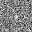

# Science (fixture)

## In plain language
Fixture paragraph with **bold**, *italic*, `code` and a [link](https://example.invalid).

- first point
- second point

## Technical account
1. Step one
2. Step two

| quantity | value |
|---|---|
| fixture | 1.0 |



> Fixture quote.

```
python scripts/fixture.py --all
```
<script>alert('this must render as text')</script>
